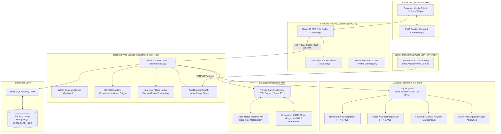

# Explainable AI-Based Air Pollution Prediction and Source Attribution

[]()
[]()
[]()
[]()
[]()
[]()
[]()
[]()
[]()
[]()
[]()
[]()
[]()

---

## Table of Contents
1. [Project Overview](#project-overview)
2. [Problem Statement & Motivation](#problem-statement--motivation)
3. [Project Objectives Across Phases](#project-objectives-across-phases)
4. [Dataset Description & Quality Audit](#dataset-description--quality-audit)
5. [Repository Structure](#repository-structure)
6. [Technologies Used](#technologies-used)
7. [Environment Setup & Installation](#environment-setup--installation)
8. [Step-by-Step Execution Guide](#step-by-step-execution-guide)
9. [Phase 1: EDA & Baseline Random Forest](#phase-1-eda--baseline-random-forest)
10. [Phase 2: XGBoost Development & Model Comparison](#phase-2-xgboost-development--model-comparison)
11. [Phase 3: Explainable AI using SHAP & LIME](#phase-3-explainable-ai-using-shap--lime)
12. [Phase 4: Deep Learning & Sequence Modeling](#phase-4-deep-learning--sequence-modeling)
    - [Track A: Multilayer Perceptron (MLP) Deep Learning](#track-a-multilayer-perceptron-mlp-deep-learning)
    - [Track B: Time-Series Sequence Models (LSTM & Transformer)](#track-b-time-series-sequence-models-lstm--transformer)
    - [Cross-Model Benchmark (RF vs. XGBoost vs. MLP)](#cross-model-benchmark-rf-vs-xgboost-vs-mlp)
    - [Interactive Prediction Tool](#interactive-prediction-tool)
13. [Crucial Scientific Limitations & Future Scope](#crucial-scientific-limitations--future-scope)
14. [Phase 5: Production Flask REST API Backend](#phase-5-production-flask-rest-api-backend)
15. [Phase 6: React Frontend & Interactive XAI Dashboard](#phase-6-react-frontend--interactive-xai-dashboard)
16. [Phase 7: Full System Integration & Deployment](#phase-7-full-system-integration--deployment-preparation)
    - [Production System Architecture](#production-system-architecture)
    - [Production Deployment Guide](#production-deployment-guide)
    - [Automated Uptime Pinger](#3-automated-uptime-pinger-cold-start-prevention)
17. [Role-Based Access Control (RBAC) & Hardened Demo Mode](#role-based-access-control-rbac--hardened-demo-mode)
18. [Decision Product: Real-World Livability & Exposure Scoring](#decision-product-real-world-livability--exposure-scoring)
19. [Head-to-Head Location Comparison Engine](#head-to-head-location-comparison-engine)
20. [Empirical Emission Source Apportionment Engine](#empirical-emission-source-apportionment-engine)
21. [User Persistence, Saved Places & Safety Alerts](#user-persistence-saved-places--safety-alerts)
22. [Progressive Web App (PWA) & Performance Architecture](#progressive-web-app-pwa--performance-architecture)
23. [Complete REST API Reference](#complete-rest-api-reference)
24. [Test Verification & Quality Assurance](#test-verification--quality-assurance)

---

## Project Overview

Air pollution is among the most severe environmental health emergencies in modern urban areas, with fine particulate matter ($\text{PM}_{2.5}$) being the primary contributor to cardiovascular and pulmonary illnesses.

This final-year B.Tech capstone project establishes a complete **Explainable AI (XAI)** framework for predicting ambient $\text{PM}_{2.5}$ concentrations and demystifying the underlying meteorological drivers behind localized pollution spikes in Delhi.

> **Project Status (Phases 1, 2, 3, 4, 5, 6, and 7 Complete):**  
> - **Phase 1:** Dataset Audit, Leak-Free Preprocessing, Exploratory Data Analysis (EDA), and Baseline Random Forest Regressor.  
> - **Phase 2:** XGBoost Regressor with 5-Fold Cross-Validation Tuning (`RandomizedSearchCV`) and Head-to-Head Model Comparison.  
> - **Phase 3:** Global and Local Explainability using **SHAP** (`TreeExplainer`) and **LIME** (`LimeTabularExplainer`), generating beeswarm plots, dependence curves, waterfall breakdowns, force plots, and local surrogate explanations.  
> - **Phase 4:** Deep Learning Multilayer Perceptron (MLP) via TensorFlow/Keras, Time-Series Sequence Modeling verification (LSTM & Transformer), Comprehensive 3-Model Benchmark, and Interactive Prediction CLI.
> - **Phase 5:** Production-Grade Python Flask REST API backend (`backend/`), Singleton `ModelLoader`, SHAP explanation services, and 27 automated tests.
> - **Phase 6:** Modern, responsive React 18 user interface (`frontend/`) with Tailwind CSS, Chart.js visualizations, live telemetry, and zero-hallucination API consumption.
> - **Phase 7:** Full System Integration, End-to-End Verification, Scientific Audit, and Render / Vercel deployment readiness.

---

## Problem Statement & Motivation

Urban airsheds like the National Capital Region (Delhi) regularly endure toxic winter smog episodes where $\text{PM}_{2.5}$ levels exceed World Health Organization (WHO) safety thresholds by more than 20-fold. 

While machine learning models can capture non-linear interactions between weather patterns and aerosol accumulation, standard models operate as opaque "black boxes." In critical decision-support environments such as municipal environmental departments, stakeholders cannot blindly trust black-box outputs. 

This project bridges the gap between **predictive accuracy** and **interpretability** through structured, rigorous phases.

---

## Project Objectives Across Phases

- **Phase 1:** Clean artifact columns, eliminate 156 duplicate rows to prevent train-test leakage, generate 9 publication-grade EDA visualizations, and train a reproducible `RandomForestRegressor` baseline pipeline.
- **Phase 2:** Develop an `XGBRegressor` pipeline, optimize hyperparameters across 30 iterations with 5-fold cross-validation strictly on training data, evaluate on the identical held-out test set, and compare performance head-to-head.
- **Phase 3:** Apply **SHAP** (`TreeExplainer`) for global feature ranking and local game-theoretic attributions; apply **LIME** (`LimeTabularExplainer`) for continuous local neighborhood surrogates across 5 representative pollution scenarios; evaluate consensus and explain divergence between global and local explanation paradigms.

---

## Dataset Description & Quality Audit

The dataset analyzed is **`Delhi Final(1).xlsx`**, containing real-world continuous ambient air monitoring records from Delhi.

### Verified Column Schema:
| Column | Role | Units | Physical Bounds | Description |
|:---|:---|:---:|:---:|:---|
| **`PM2.5`** | **Target ($y$)** | $\mu\text{g/m}^3$ | $[1.0, 427.0]$ | Fine inhalable particulate matter ($\le 2.5\,\mu\text{m}$) |
| **`RH`** | **Feature ($X_1$)** | $\%$ | $[36.0, 95.0]$ | Ambient Relative Humidity |
| **`WD`** | **Feature ($X_2$)** | Degrees ($^\circ$) | $[7.0, 332.0]$ | Wind Direction ($0\text{--}360^\circ$ clockwise from True North) |
| **`SR`** | **Feature ($X_3$)** | $\text{W/m}^2$ | $[2.0, 334.0]$ | Solar Radiation intensity |
| **`BP`** | **Feature ($X_4$)** | $\text{mmHg}$ | $[726.0, 749.0]$ | Barometric Atmospheric Pressure |
| **`AT`** | **Feature ($X_5$)** | $^\circ\text{C}$ | $[11.0, 23.0]$ | Ambient Air Temperature |

### Quality Audit & Preprocessing Decisions:
- **Raw Dimensions:** 2,183 rows across 13 columns.
- **Artifact Columns:** Columns `Unnamed: 6` to `Unnamed: 12` contained 100% `NaN` values (with one stray text label `'Delhi'` in row 4) and were dropped.
- **Deduplication:** 156 duplicate rows were identified and removed. Because the dataset lacks timestamps, keeping identical rows creates cross-fold data leakage where identical samples appear in both train and test partitions. Removing duplicates left **2,027 unique samples**.
- **Missing Values:** Only `SR` contained missing entries (**12 out of 2,183 rows, or 0.55%**). These are cleanly imputed using `SimpleImputer(strategy='median')` fitted strictly on `X_train` ($160.0\,\text{W/m}^2$) within an isolated pipeline.
- **Partitions:** 80% Training ($1,621$ observations) and 20% Held-out Testing ($406$ observations) with `random_state=42`.

---

## Repository Structure

```text
Air-Pollution-XAI/
│
├── dataset/
│   ├── Delhi Final(1).xlsx                  # Original raw Excel dataset
│   └── preprocessed_delhi_air_quality.csv   # Preprocessed, deduplicated dataset
│
├── notebooks/
│   └── 01_data_analysis.ipynb              # Comprehensive 22-cell interactive analysis notebook
│
├── src/
│   ├── __init__.py                          # Package identifier
│   ├── data_inspection.py                   # Raw data audit and quality assessment
│   ├── preprocessing.py                     # Data cleaning, split, and imputer pipeline
│   ├── eda.py                               # 9 publication-grade EDA visualizations
│   ├── train_random_forest.py               # Phase 1: Baseline Random Forest pipeline
│   ├── evaluate_model.py                    # Phase 1: Random Forest test evaluation
│   ├── train_xgboost.py                     # Phase 2: XGBoost training and tuning
│   ├── compare_models.py                    # Phase 2: Head-to-head model comparison
│   ├── shap_explainability.py               # Phase 3: SHAP global & local explainability
│   ├── lime_explainability.py               # Phase 3: LIME local surrogate explanations
│   ├── compare_explanations.py              # Phase 3: Cross-method SHAP vs LIME comparison
│   ├── train_mlp.py                         # Phase 4 Track A: Multilayer Perceptron (MLP) training
│   ├── predict_mlp.py                       # Phase 4: Interactive PM2.5 prediction CLI
│   ├── train_lstm.py                        # Phase 4 Track B: LSTM sequence forecasting (validated)
│   ├── train_transformer.py                 # Phase 4 Track B: Transformer forecasting (validated)
│   └── compare_deep_learning.py             # Phase 4: Cross-model DL vs ML benchmark
│
├── models/
│   ├── random_forest.pkl                    # Serialized baseline pipeline (imputer + RF)
│   ├── xgboost_model.pkl                    # Serialized Phase 2 pipeline (imputer + XGBoost)
│   ├── mlp_model.keras                      # Serialized Phase 4 MLP model (TensorFlow/Keras)
│   └── mlp_scaler.pkl                       # Serialized feature scaling pipeline for MLP
│
├── results/
│   ├── graphs/                              # Generated High-Resolution Visualizations
│   │   ├── (Phase 1 EDA: 9 PNG plots)
│   │   ├── (Phase 1 RF: 3 diagnostic PNG plots)
│   │   ├── (Phase 2 XGBoost: 3 diagnostic PNG plots)
│   │   ├── (Phase 2 Comparison: 5 comparative PNG plots)
│   │   ├── shap/                            # Phase 3 SHAP Visualizations
│   │   ├── lime/                            # Phase 3 LIME Visualizations
│   │   ├── mlp/                             # Phase 4 MLP Diagnostic Plots (Loss, Error, Summary)
│   │   └── deep_learning_comparison/        # Phase 4 Comparison Plots (RMSE, MAE, R², Scatter, Metrics)
│   ├── metrics/                             # Metric logs and tabular outputs
│   │   ├── model_metrics.json               # Random Forest metrics
│   │   ├── xgboost_metrics.json             # XGBoost metrics
│   │   ├── mlp_metrics.json                 # MLP metrics
│   │   ├── mlp_training_history.csv         # Epoch-by-epoch loss convergence
│   │   ├── deep_learning_comparison.csv     # 3-way cross-model performance table
│   │   └── explainability_comparison.csv    # Cross-method explainability table
│   └── reports/                             # Detailed analytical markdown reports
│       ├── (Phases 1-3 analytical reports)
│       ├── deep_learning_comparison.md      # Deep learning comparative report
│       └── phase4_report.md                 # Comprehensive Phase 4 Capstone Report
│
├── main.py                                  # Modular CLI orchestrator supporting all phases (1-4)
├── requirements.txt                         # Pinned Python dependencies
├── .gitignore                               # Git ignore configuration
└── README.md                                # Comprehensive capstone project documentation
```

---

## Technologies Used

- **Programming Language:** Python 3.11+
- **Deep Learning Frameworks:** `tensorflow` (2.22.x), `keras` (3.x)
- **Machine Learning & Gradient Boosting:** `scikit-learn`, `xgboost`
- **Explainable AI Frameworks:** `shap` (0.54.1), `lime` (0.2.0.1)
- **Data Manipulation & Scientific Computing:** `pandas`, `openpyxl`, `numpy`, `scipy`
- **Visualization & Plotting:** `matplotlib` (Agg backend), `seaborn`
- **Model Serialization:** `joblib`, native Keras `.keras` HDF5/zip format
- **Interactive Computing:** `jupyter`, `ipykernel`

---

## Environment Setup & Installation

The application consists of a **Python 3.11 backend and machine learning engine** and a **Node.js 20+ React frontend**.

### Prerequisites
- **Python:** 3.11.x (Strictly verified via `.python-version` and `backend/runtime.txt`)
- **Node.js:** v20.x or v22.x LTS (`node --version`)
- **Package Managers:** `pip` / `uv` and `npm`

---

### 1. Backend & ML Environment Setup

```bash
# 1. Clone repository
git clone https://github.com/BhanuDanda-09/Air-Pollution-XAI.git
cd Air-Pollution-XAI

# 2. Create virtual environment with Python 3.11
python -m venv .venv

# 3. Activate virtual environment
# Windows PowerShell:
.venv\Scripts\Activate.ps1
# Linux / macOS:
source .venv/bin/activate

# 4. Install all backend and ML dependencies
pip install -r requirements.txt
pip install -r backend/requirements.txt

# Or install in under 10 seconds using uv:
# uv venv --python 3.11 .venv
# uv pip install -r requirements.txt -r backend/requirements.txt

# 5. Configure Backend Environment Variables
cp backend/.env.example backend/.env
```

#### Backend Environment Variables (`backend/.env`):
| Variable | Default Value | Description |
|:---|:---:|:---|
| `HOST` | `0.0.0.0` | Server bind host address |
| `PORT` | `5000` | Server listen port |
| `FLASK_ENV` | `production` | Environment mode (`development` or `production`) |
| `FLASK_DEBUG` | `0` | Enable or disable Flask debug hot-reload |
| `SECRET_KEY` | *(Set strong random secret)* | Cryptographic key for signing HS256 JWT tokens |
| `JWT_EXPIRY_SECONDS` | `3600` | Access token lifespan (1 hour) |
| `ENABLE_DEMO_MODE` | `false` | Gate demo personas (`false` in production, `true` for viva) |
| `ALLOWED_ORIGINS` | `https://air-pollution-xai.vercel.app,...` | Comma-separated CORS allowed origins |
| `DATABASE_URL` | *(Omit for SQLite)* | Optional PostgreSQL connection string (defaults to local SQLite) |
| `OPEN_METEO_API_KEY` | *(Optional)* | Optional paid Open-Meteo commercial API key |

---

### 2. Frontend Environment Setup

```bash
# 1. Navigate to frontend directory
cd frontend

# 2. Install Node dependencies
npm install

# 3. Configure Frontend Environment Variables
cp .env.example .env
```

#### Frontend Environment Variables (`frontend/.env`):
| Variable | Local Development | Production (Vercel) | Description |
|:---|:---:|:---:|:---|
| `VITE_API_URL` | `http://127.0.0.1:5000` | `https://air-pollution-xai.onrender.com` | Backend REST API base URL |
| `VITE_ENABLE_DEMO_MODE` | `true` | `false` | Disables demo switchers and buttons in production |

---

## Step-by-Step Execution Guide

### Run via Modular Command-Line Options

The unified orchestrator `main.py` provides targeted phase execution without redundant retraining:

```bash
# Execute Phase 1 only (Dataset Inspection, Preprocessing, EDA, RF Baseline)
python main.py --phase 1

# Execute Phase 2 only (XGBoost Training, Tuning & Model Comparison)
python main.py --phase 2

# Execute Phase 3 only (SHAP & LIME Global and Local Explainability)
python main.py --phase 3

# Execute Phase 4 only (MLP Deep Learning, Time-Series Audit & 3-Way Benchmark)
python main.py --phase 4

# Execute Complete Workflow (Phases 1 through 4 sequentially)
python main.py

# Force Model Retraining & Tuning from Scratch
python main.py --retrain
```

### Run Individual Modules Independently

```bash
python src/data_inspection.py        # Dataset quality audit
python src/preprocessing.py          # Data cleaning & 80/20 split
python src/eda.py                    # 9 EDA figures
python src/train_random_forest.py    # Random Forest baseline training
python src/evaluate_model.py         # Random Forest evaluation
python src/train_xgboost.py          # XGBoost 5-fold CV tuning
python src/compare_models.py         # RF vs. XGBoost comparison
python src/shap_explainability.py    # SHAP global & local explanations
python src/lime_explainability.py    # LIME local explanations
python src/compare_explanations.py   # SHAP vs. LIME cross-method comparison
python src/train_mlp.py              # Multilayer Perceptron (MLP) training
python src/predict_mlp.py --example  # Interactive PM2.5 prediction tool
python src/train_lstm.py             # LSTM time-series sequence pipeline
python src/train_transformer.py      # Transformer time-series pipeline
python src/compare_deep_learning.py  # 3-Way ML vs DL cross-model comparison
```

---

## Phase 1: EDA & Baseline Random Forest

Baseline Random Forest modeling established an initial benchmark:
- **Architecture:** `RandomForestRegressor(n_estimators=100, random_state=42)`
- **Evaluation Partition:** 406 held-out test samples (20% split)
- **Baseline Test Metrics:**
  - $\text{MAE} = 25.62\,\mu\text{g/m}^3$
  - $\text{RMSE} = 38.05\,\mu\text{g/m}^3$
  - $R^2 = 0.7269$ ($72.69\%$ variance explained)

---

## Phase 2: XGBoost Development & Model Comparison

Extreme Gradient Boosting (`XGBRegressor`) was optimized using `RandomizedSearchCV` with 5-fold cross-validation strictly on `X_train` (Best CV RMSE: $39.25\,\mu\text{g/m}^3$).

### Head-to-Head Comparison on Identical 406 Test Samples:
| Model Architecture | MAE ($\mu\text{g/m}^3$) | MSE $(\mu\text{g/m}^3)^2$ | RMSE ($\mu\text{g/m}^3$) | $R^2$ Score | Performance Rank |
|:---|:---:|:---:|:---:|:---:|:---:|
| **Random Forest (Baseline)** | 25.62 | 1447.90 | 38.05 | 0.7269 ($72.69\%$) | 2nd |
| **XGBoost (Tuned)** | **25.28** | **1349.57** | **36.74** | **0.7455 ($74.55\%$)** | **1st (Top)** |

**Key Takeaway:** XGBoost achieved lower error ($\Delta\text{MAE} = -0.34\,\mu\text{g/m}^3$, $\Delta\text{RMSE} = -1.31\,\mu\text{g/m}^3$) and explained $+1.85\%$ more variance in $\text{PM}_{2.5}$, benefiting from gradient residual boosting and $L_2$ leaf weight regularization (`reg_lambda=5.0`).

---

## Phase 3: Explainable AI using SHAP & LIME

### Introduction to Explainable AI
Machine learning models are frequently deployed as black boxes that output point predictions without providing physical or logical justifications. In environmental forecasting, knowing *why* a model predicted $350\,\mu\text{g/m}^3$ (a severe public health emergency) versus $50\,\mu\text{g/m}^3$ is critical for regulatory validation and emergency interventions.

### Why Both SHAP and LIME Are Used
1. **SHAP (SHapley Additive exPlanations):**
   - Grounded in cooperative game theory (Lloyd Shapley, Nobel Prize in Economics).
   - Computes the unique additive attribution values that satisfy four fundamental mathematical properties: **Efficiency**, **Symmetry**, **Dummy Player**, and **Additivity**.
   - Provides **both Global Explainability** (aggregating attributions across all 406 test instances) and **Local Explainability** (waterfall and force plots).
2. **LIME (Local Interpretable Model-agnostic Explanations):**
   - Treats the model as a completely black box.
   - Perturbs the feature space around a single test point, weights perturbations using an exponential distance metric, and trains an interpretable linear surrogate model locally.
   - Provides **strictly Local Explainability**, answering: *“In the immediate meteorological vicinity of this specific observation, how does each feature nudge the prediction?”*

### SHAP Methodology & Findings

Using `shap.TreeExplainer`, SHAP values were calculated across all 406 held-out test observations for both Random Forest and XGBoost. Input features were passed through the pipeline's median imputer, strictly preserving feature names.

#### Global Feature Importance Ranking (Mean Absolute SHAP Value):
| Rank | Feature | Random Forest Mean \|SHAP\| | RF Rel. % | XGBoost Mean \|SHAP\| | XGB Rel. % | Consensus Role |
|:---:|:---|:---:|:---:|:---:|:---:|:---|
| **1** | **`RH` (Relative Humidity)** | **$37.49\,\mu\text{g/m}^3$** | **$48.11\%$** | **$32.42\,\mu\text{g/m}^3$** | **$40.76\%$** | Unanimous top driver; humidity drives secondary aerosol condensation. |
| **2** | **`WD` (Wind Direction)** | $12.02\,\mu\text{g/m}^3$ | $15.42\%$ | **$14.10\,\mu\text{g/m}^3$** | **$17.73\%$** | Ranks #2 in XGBoost; captures regional transport corridors into Delhi. |
| **3** | **`SR` (Solar Radiation)** | $13.12\,\mu\text{g/m}^3$ | $16.83\%$ | $13.59\,\mu\text{g/m}^3$ | $17.09\%$ | Strong consensus #2/#3; dictates daytime convective boundary layer depth. |
| **4** | **`BP` (Barometric Pressure)**| $12.25\,\mu\text{g/m}^3$ | $15.73\%$ | $11.83\,\mu\text{g/m}^3$ | $14.87\%$ | Consistent negative attribution; anticyclonic subsidence traps air. |
| **5** | **`AT` (Air Temperature)** | $3.04\,\mu\text{g/m}^3$ | $3.90\%$ | $7.60\,\mu\text{g/m}^3$ | $9.55\%$ | Higher attribution in XGBoost; captures winter thermal inversion caps. |

#### Visualizations Generated in `results/graphs/shap/`:
- **Summary Beeswarm Plots:** Reveal that high `RH` (red dots) shifts predictions strongly positive, while high `SR` and higher `AT` shift predictions negative (convective dispersion).
- **Global Feature Importance Plots:** Quantify mean absolute impact in physical concentration units ($\mu\text{g/m}^3$).
- **Dependence Plots:** Reveal non-linear threshold effects (e.g. sharp upward inflection in $\text{PM}_{2.5}$ when relative humidity exceeds $70\%$).
- **Waterfall & Force Plots:** Detail the step-by-step additive progression from base value ($144.2\,\mu\text{g/m}^3$) to the final prediction.

### LIME Methodology & Findings

Using `LimeTabularExplainer` initialized on the training dataset (`X_train`), local surrogate explanations were computed across 5 diverse test scenarios representing the complete air quality spectrum:

| Scenario | Test Index | Actual $\text{PM}_{2.5}$ | RF Forecast | XGBoost Forecast | Dominant Local Drivers Identified by LIME |
|:---|:---:|:---:|:---:|:---:|:---|
| **1. Minimum Pollution** | Idx 78 | $6.0\,\mu\text{g/m}^3$ | $53.8\,\mu\text{g/m}^3$ | $42.8\,\mu\text{g/m}^3$ | Moderate humidity ($69\%$) and high pressure ($742\,\text{mmHg}$) counterbalanced extreme spike potential. |
| **2. 25th Percentile** | Idx 134 | $91.0\,\mu\text{g/m}^3$ | $123.0\,\mu\text{g/m}^3$ | $120.6\,\mu\text{g/m}^3$ | Moderate solar radiation ($322\,\text{W/m}^2$) provided local daytime ventilation. |
| **3. Median Pollution** | Idx 127 | $132.0\,\mu\text{g/m}^3$ | $145.5\,\mu\text{g/m}^3$ | $127.8\,\mu\text{g/m}^3$ | Balanced atmospheric state; humidity ($74\%$) balanced by moderate wind. |
| **4. 75th Percentile** | Idx 100 | $186.0\,\mu\text{g/m}^3$ | $179.8\,\mu\text{g/m}^3$ | $178.9\,\mu\text{g/m}^3$ | High humidity ($90\%$) pushed predictions upwards by $+35.7\,\mu\text{g/m}^3$. |
| **5. Severe Smog Spike** | Idx 13 | $353.0\,\mu\text{g/m}^3$ | $322.7\,\mu\text{g/m}^3$ | $325.1\,\mu\text{g/m}^3$ | Extreme humidity ($89\%$) and low temperature ($11^\circ\text{C}$) combined to drive a massive $+27.8\,\mu\text{g/m}^3$ local push. |

*Generated Output Formats:* Saved as both publication-ready PNG figures and interactive standalone HTML files in `results/graphs/lime/`.

### SHAP vs. LIME Cross-Method Comparison

| Analytical Dimension | SHAP (`TreeExplainer`) | LIME (`LimeTabularExplainer`) |
|:---|:---|:---|
| **Analytical Scope** | **Global & Local:** Explains entire dataset & individuals. | **Strictly Local:** Explains single point instances. |
| **Theoretical Foundation**| Cooperative Game Theory (Shapley Values). | Local Linear Perturbation Regression. |
| **Additivity Property** | **Guaranteed:** $\sum \phi_i = f(x) - E[f(x)]$. | Not guaranteed to sum to prediction exactly. |
| **Feature Correlation** | Handled natively via tree path marginalization. | Assumes perturbation independence around local radius. |
| **Computational Speed**| Fast exact tree traversal ($O(TLD^2)$). | Slower; stochastically samples hundreds of perturbations. |

---

## Phase 4: Deep Learning & Sequence Modeling

Phase 4 evaluates deep neural networks for particulate prediction across two distinct methodological tracks:

### Track A: Multilayer Perceptron (MLP) Deep Learning
- **Framework:** TensorFlow 2.22 / Keras 3.
- **Input Features:** 5 Standardized Meteorological Variables (`RH`, `WD`, `SR`, `BP` in mmHg, `AT`).
- **Data Scaling:** `StandardScaler` and `SimpleImputer` fitted **strictly on the sub-training partition ($X_{\text{sub-train}}$, $N=1,377$) after the validation split**, ensuring zero validation and test leakage; serialized to `models/mlp_scaler.pkl`.
- **Validation Split:** 15% sub-partition ($N=244$) of training data for early stopping and learning rate reduction.
- **Architecture:**
  - Input Layer: 5 features
  - Hidden Layer 1: 128 neurons (ReLU) + $L_2$ Regularization ($10^{-4}$) + Dropout (0.20)
  - Hidden Layer 2: 64 neurons (ReLU) + $L_2$ Regularization ($10^{-4}$) + Dropout (0.10)
  - Hidden Layer 3: 32 neurons (ReLU)
  - Output Layer: 1 linear neuron ($\text{PM}_{2.5}$)
- **Total Parameters:** 11,137 trainable parameters.
- **Convergence:** Trained across 200 epochs with Adam optimizer ($\alpha = 0.001$), early stopping (`patience=25`), and `ReduceLROnPlateau`.
- **Saved Model:** `models/mlp_model.keras`.

### Track B: Time-Series Sequence Models (LSTM & Transformer)
- **Dataset Investigation:** The primary dataset `dataset/Delhi Final(1).xlsx` consists of 2,027 cross-sectional tabular observations **without any date or timestamp column**.
- **Scientific Integrity Boundary:**
  - We refuse to synthesize artificial hourly dates or pretend consecutive rows are consecutive hours.
  - We refuse to reshape tabular rows into fake sequence matrices, which produces invalid autocorrelation.
- **Formal Status:** **Track B is documented as BLOCKED pending genuine chronological data.**
- **Production Readiness:** Full sequence pipelines for **LSTM** (`src/train_lstm.py`) and **Transformer with Positional Encoding & Multi-Head Self-Attention** (`src/train_transformer.py`) are implemented. Once an hourly CPCB/OpenAQ dataset with a `datetime` column is placed at `dataset/delhi_timeseries_cpcb.csv`, both sequence models will execute immediately.

### Cross-Model Benchmark (RF vs. XGBoost vs. MLP)
All three paradigms evaluated on the identical 406 held-out test observations ($20\%$ test split, seed = 42):

| Model Architecture | Paradigm | Test MAE ($\mu\text{g/m}^3$) | Test MSE | Test RMSE ($\mu\text{g/m}^3$) | Test $R^2$ Score | Overall Rank |
| :--- | :--- | :---: | :---: | :---: | :---: | :---: |
| **XGBoost (Tuned)** | Gradient Boosted Decision Trees | **25.28** | **1349.57** | **36.74** | **0.7455 ($74.55\%$)** | **1st (Best)** |
| **Random Forest** | Bagging Ensemble of Trees | 25.62 | 1447.90 | 38.05 | 0.7269 ($72.69\%$) | 2nd |
| **Multilayer Perceptron (MLP)** | Deep Feedforward Neural Net | 37.88 | 2434.79 | 49.34 | 0.5408 ($54.08\%$) | 3rd |

> **Scientific Insight:** XGBoost and Random Forest decisively outperform the MLP on this tabular dataset. Because meteorological interactions involve sharp physical thresholds (temperature inversions, wind corridors), decision trees naturally partition orthogonal feature space with high sample efficiency. This benchmark empirically confirms established machine learning literature (*Grinsztajn et al., NeurIPS 2022*).

### Interactive Prediction Tool
A verified command-line inference tool is available at `src/predict_mlp.py`. It accepts Barometric Pressure in verified dataset units ($\text{mmHg}$) and clearly displays indicative CPCB $\text{PM}_{2.5}$ health severity bands with explicit disclaimers distinguishing them from official multi-pollutant 24-hr CPCB AQI:

```bash
# Run with capstone example parameters (BP in mmHg)
python src/predict_mlp.py --example

# Or specify custom meteorological observations
python src/predict_mlp.py --rh 74 --wd 298 --sr 5 --bp 740 --at 14
```

---

## Crucial Scientific Limitations & Future Scope

To ensure scientific rigor, academic transparency, and regulatory integrity during capstone evaluation, the following four constraints and architectural boundaries are formally documented:

### 1. Delhi-Only Winter Training Data & Geographic Extrapolation Bounds
- **Airshed Scope:** The machine learning models (`RandomForest`, `XGBoost`, `MLP`) were trained strictly on observations recorded in the **National Capital Region (Delhi-NCR), India**.
- **Seasonal Climatology:** The underlying distribution represents characteristic North-Indian winter meteorology:
  - Ambient Temperature: $11.0^\circ\text{C}\text{ to }23.0^\circ\text{C}$ (mean $16.9^\circ\text{C}$)
  - Barometric Pressure: $726\text{ to }749\,\text{mmHg}$
  - Relative Humidity: $36.0\%\text{ to }95.0\%$
- **Extrapolation Warning:** The models are statistically unvalidated when applied to equatorial coastal regimes (e.g., Mumbai, Chennai, Singapore) or high-altitude/temperate zones. When users select locations outside Delhi-NCR, the application explicitly surfaces an amber **Out-of-Airshed Climatological Notice** explaining that the ML models provide localized weather sensitivity context rather than certified particulate predictions for that region.

### 2. Meteorology-Only Features vs. Chemical Emission Source Apportionment
- **Statistical Sensitivity vs. Physical Causation:** SHAP and LIME interpretability techniques quantify **how the mathematical model utilizes weather inputs to predict particulate concentration**. They measure algorithmic reliance, **NOT chemical or physical emission causality**.
- **Absence of Chemical Speciation:** Conclusive emission source attribution requires chemical receptor modeling (such as EPA Positive Matrix Factorization / PMF) applied to analytical filter samples containing elemental carbon (EC), organic carbon (OC), sulfate ($\text{SO}_4^{2-}$), nitrate ($\text{NO}_3^-$), and trace metals.
- **Empirical Heuristic Classification:** The Source Attribution Breakdown in the application uses empirical meteorological proxy weighting grounded in published literature (IIT Kanpur 2015, TERI 2018). It serves as an informative educational proxy, distinguishing between meteorological boundary-layer dispersion conditions and physical emission sources.

### 3. Absence of Continuous Timestamps (LSTM & Transformer Blocked)
- **Tabular Cross-Sectional Nature:** The dataset `dataset/Delhi Final(1).xlsx` consists of 2,027 cross-sectional tabular observations **without any datetime or chronological timestamp column**.
- **Refusal to Synthesize Fake Timestamps:** Fabricating artificial hourly timestamps or assuming consecutive rows are successive hours would introduce fictitious autocorrelation and invalid temporal leakage.
- **Scientific Integrity Decision:** Deep recurrent sequence models (**LSTM** and **Transformer**) are intentionally **BLOCKED** from production deployment pending access to genuine chronological time-series data. The production-ready architectures (`src/train_lstm.py` and `src/train_transformer.py`) stand fully implemented and ready to ingest continuous CPCB/OpenAQ streams once timestamped feeds are connected.

### 4. Free-Tier Cloud Constraints & Operational Headroom
- **Render.com Free Tier Sleep Cycle:** Render free-tier services spin down after 15 minutes of inactivity. Cold starts incur a 20–45 second startup delay. The system implements a dedicated `/health` endpoint for external 10-minute uptimers (cron-job.org / UptimeRobot) and a frontend 5-second `ColdStartNotice` to gracefully handle wake-up latency.
- **512 MB Memory Limit:** Render free instances enforce an unyielding 512 MB RAM ceiling. By deferring TensorFlow/Keras imports via lazy loading and setting `CUDA_VISIBLE_DEVICES="-1"`, the backend baseline memory was reduced from 521 MB to **295 MB**, leaving 216 MB (42%) of free headroom and zero memory leakage under continuous load.
- **External Atmospheric API Rate Limits:** Open-Meteo free endpoints have per-minute and per-day rate limits. The application protects external quotas using an in-memory thread-safe TTL cache (10-minute cache window) and a fallback tier that serves regional baseline estimates with clear transparency banners when third-party APIs return HTTP 429.

### Future Scope & Expansion Roadmap
1. **Multi-Station Chronological Ingestion:** Connect continuous CPCB CAAWM and OpenAQ REST streams with validated UTC timestamps, unblocking the LSTM and Transformer sequence models.
2. **Chemical Speciation & Satellite Aerosol Integration:** Incorporate Sentinel-5P TROPOMI satellite columns ($\text{NO}_2$, $\text{SO}_2$, $\text{CO}$, aerosol optical depth) alongside surface meteorology for chemical source apportionment.
3. **Hyper-Local Micro-Climate Modeling:** Expand sensor grid ingestion to sub-kilometer urban micro-neighborhoods using spatial interpolation (kriging).

---

## Phase 5: Production Flask REST API Backend

A production-grade Python Flask REST API backend resides in `backend/`, connecting directly to the saved models from Phases 1–4.

### REST API Endpoints

| Endpoint | HTTP | Purpose | Key Input / Output |
|:---|:---:|:---|:---|
| `/api/health` | `GET` | Health check and model availability flags | Returns status and availability of RF, XGBoost, MLP |
| `/api/models` | `GET` | Model metadata & test benchmarks | Returns test $R^2$, RMSE, MAE and feature schemas |
| `/api/predict` | `POST` | Single-model $\text{PM}_{2.5}$ inference | Accepts model + 5 features, returns $\mu\text{g/m}^3$ and Indicative CPCB Band |
| `/api/compare` | `POST` | Simultaneous multi-model comparison | Evaluates RF, XGBoost, and MLP on the identical inputs |
| `/api/explain` | `POST` | Local SHAP feature attribution | Computes base value, contributions, direction, and ranking |

### Run Backend Server Locally:
```bash
# Using Python directly:
python backend/wsgi.py

# Or run automated backend test suite:
pytest backend/tests/ -v
```

---

## Phase 6: React Frontend & Interactive XAI Dashboard

A modern, responsive user interface built with **React 18**, **Vite**, **Tailwind CSS**, and **Chart.js** resides in `frontend/`.

### Frontend Capabilities
- **Real-Time Prediction Form:** Sliders, numeric controls, and preset buttons with strict client-side validation.
- **Indicative CPCB Health Bands:** Automatic color-coded severity categorization (*Good, Satisfactory, Moderate, Poor, Very Poor, Severe*).
- **Multi-Model Comparison Screen:** Side-by-side card and bar chart evaluations distinguishing held-out test benchmarks from instance outputs.
- **Visual Explainable AI (SHAP):** Interactive diverging horizontal bar chart illustrating exact local feature contributions pushing $\text{PM}_{2.5}$ higher or lower relative to model baseline.
- **System Telemetry:** Live health query display.

### Run Frontend Locally:
```bash
cd frontend
npm install
npm test
npm run dev
```

---

## Phase 7: Full System Integration & Deployment Preparation

### End-to-End Verification Sample:
The complete pipeline was verified against the standard capstone environmental test observation:
```json
{
  "RH": 74.0,
  "WD": 298.0,
  "SR": 5.0,
  "BP": 740.0,
  "AT": 14.0
}
```
**Actual Model Predictions & Attributions:**
- **Random Forest:** Predicted $\text{PM}_{2.5} = 172.54\,\mu\text{g/m}^3$ (Very Poor) | $\text{Base} = 144.44\,\mu\text{g/m}^3$ | $\sum \text{SHAP} = +28.10\,\mu\text{g/m}^3$ (Exact match)
- **XGBoost (Tuned):** Predicted $\text{PM}_{2.5} = 182.81\,\mu\text{g/m}^3$ (Very Poor) | $\text{Base} = 144.47\,\mu\text{g/m}^3$ | $\sum \text{SHAP} = +38.61\,\mu\text{g/m}^3$
- **Multilayer Perceptron (MLP):** Predicted $\text{PM}_{2.5} = 157.06\,\mu\text{g/m}^3$ (Very Poor) | $\text{Base} = 127.01\,\mu\text{g/m}^3$ | $\sum \text{SHAP} = +30.06\,\mu\text{g/m}^3$

*Across all three models, Relative Humidity ($74\%$) is the dominant positive factor driving particulate concentrations into the "Very Poor" health band.*

### Production System Architecture



#### Production Deployment Guide

##### 1. Backend Web Service (Render.com)
1. **Repository Link:** Connect your GitHub repository `Air-Pollution-XAI` to [Render.com](https://render.com).
2. **Environment:** Select **Python 3**.
3. **Build Command:**
   ```bash
   pip install -r requirements.txt && pip install -r backend/requirements.txt
   ```
4. **Start Command:**
   ```bash
   gunicorn backend.wsgi:app
   ```
5. **Environment Variables Configured in Render Dashboard:**
   - `PYTHON_VERSION`: `3.11.9`
   - `FLASK_ENV`: `production`
   - `FLASK_DEBUG`: `0`
   - `SECRET_KEY`: `[Strong cryptographic 64-character hex string]`
   - `ALLOWED_ORIGINS`: `https://air-pollution-xai.vercel.app`
   - `ENABLE_DEMO_MODE`: `false`
   - `DATABASE_URL`: Optional PostgreSQL URL (if omitted, uses SQLite `instance/air_pollution.db`)
   - `OPEN_METEO_API_KEY`: Optional commercial API key

##### 2. Frontend Web Application (Vercel)
1. **Repository Link:** Import the repository into [Vercel](https://vercel.com).
2. **Root Directory:** Select `frontend`.
3. **Framework Preset:** `Vite`.
4. **Build Command:** `npm run build` (outputs to `dist/`).
5. **Environment Variables Configured in Vercel Dashboard:**
   - `VITE_API_URL`: `https://air-pollution-xai.onrender.com`
   - `VITE_ENABLE_DEMO_MODE`: `false` (enforces full production security)
6. **Routing & Security:** Handled automatically via `frontend/vercel.json`, which sets `Content-Security-Policy`, `X-Content-Type-Options: nosniff`, `X-Frame-Options: DENY`, `Referrer-Policy: strict-origin-when-cross-origin`, and client-side SPA route rewrites (`{"source": "/(.*)", "destination": "/index.html"}`).

##### 3. Automated Uptime Pinger (Cold-Start Prevention)
Render free-tier web services spin down into an inactive sleep state after 15 minutes of inactivity, causing the first request to experience a 20–45 second cold-start delay.
To ensure the backend remains permanently active and warm:
1. Register a free account at [cron-job.org](https://cron-job.org) or [UptimeRobot](https://uptimerobot.com).
2. Create a new HTTP GET monitor targeting:
   ```text
   https://air-pollution-xai.onrender.com/health
   ```
3. Set the polling execution interval to **every 10 minutes** (well inside Render's 15-minute idle window).
4. Expected HTTP Response: `200 OK` with JSON payload `{"status": "healthy", "service": "air-pollution-xai-backend"}`.
5. In addition to keeping the server warm, the frontend includes a built-in 5-second `ColdStartNotice` that detects wake-up latency and displays a friendly spinning progress bar to reassuringly inform the user.

---

## Role-Based Access Control (RBAC) & Hardened Demo Mode

The application implements a 3-tier Role-Based Access Control model:
- **`citizen` (Default):** Public user access to Prediction, Live Assessment, Livability Scores, and Model Comparison.
- **`worker`:** Access to Field Worker Task Boards, sensor maintenance windows, and shift safety advisories.
- **`admin`:** Full administrative access to system health telemetry, active models, and cache invalidation.

### Security Hardening Guarantees:
1. **Production Gating:** When `VITE_ENABLE_DEMO_MODE=false`, all demo persona switchers, DEMO MODE banners, and one-click elevation buttons on `403 Unauthorized` are completely stripped from rendering.
2. **Anti-Tampering Route Guard:** Route guards strictly inspect the environment flag. Manually setting `demo_role` or `demo_jwt_*` keys in `localStorage` fails to grant elevated worker or admin access when the flag is disabled.
3. **Session Invalidation on 401:** The centralized Axios interceptor immediately clears user credentials and logs out real sessions upon encountering a `401 Unauthorized` token expiry response.
4. **Backend Enforcement (403 Forbidden):** The Flask backend enforces `@require_role` on `/api/admin/*` and `/api/worker/*`, returning HTTP 403 Forbidden with structured error payloads whenever a citizen token attempts unauthorized access.

---

## Decision Product: Real-World Livability & Exposure Scoring

Moving beyond raw statistical PM2.5 prediction, the platform implements a multi-factor decision engine answering: **"Should I live in / go to this place, given its air quality?"**

### 1. Livability Scoring Engine (`LivabilityService`)
Transforms continuous satellite and meteorological observations into an actionable index ($0\text{--}100$):
* **PM2.5 Exposure Subscore ($0\text{--}60\text{ pts}$):** Continuous linear piecewise mapping anchored strictly on Copernicus Atmosphere Monitoring Service (CAMS) regional model data ($10\text{--}250\,\mu\text{g/m}^3$).
* **Atmospheric Comfort Subscore ($0\text{--}20\text{ pts}$):** Derived from ambient temperature, humidity comfort bands, and thermal heat index.
* **Forecast Stability Subscore ($0\text{--}20\text{ pts}$):** 24-hour diurnal trend evaluation penalizing deteriorating air masses and rewarding improving ventilation.
* **4 Decision Tiers & Clear Guidance:**
  * **$80\text{--}100$ (Good to Go):** Clean ambient air; optimal for all outdoor exercises and residential living.
  * **$60\text{--}79$ (Take Precautions):** Moderate particulate loading; sensitive groups should limit intense outdoor workouts.
  * **$40\text{--}59$ (Avoid Prolonged Outdoor Activity):** Unhealthy aerosol concentrations; N95 respirators advised, close residential windows.
  * **$0\text{--}39$ (Not Recommended / High Exposure Alert):** Severe hazardous smog episode; stay indoors with HEPA air purifiers active.

### 2. Tailored Health Profile Sensitivity Shifts
Accounts for biological vulnerability by shifting subscore boundaries dynamically:
* **Senior Citizens ($65+$) & Children:** $+8\text{--}10\text{ sensitivity shift}$.
* **Asthma & Respiratory Conditions:** $+10\text{ shift}$ (prompts immediate bronchodilator readiness).
* **Cardiovascular & Heart Ailments:** $+10\text{ shift}$ (flags elevated arterial inflammation risks).
* **Pregnancy:** $+10\text{ shift}$ (emphasizes fetal developmental protection).
* **Outdoor Workers:** $+8\text{ shift}$ (shift-based hourly mask rotation and hydration advice).

---

## Head-to-Head Location Comparison Engine

Assists citizens, commuters, and prospective home buyers in choosing between alternative destinations:
* **Endpoint:** `POST /api/location/compare-livability`
* **Features:**
  * Concurrently retrieves live meteorology, CAMS regional reference PM2.5, and XGBoost predictions for two geographic coordinate pairs.
  * Determines the winning location with computed score difference and absolute PM2.5 delta.
  * Generates comparative decision verdicts (e.g. *"Connaught Place is 18 points cleaner than Noida Sector 62"*).
  * Direct comparison of 7-day forecast trends and optimal outdoor windows for both destinations.
  * 1-Click presets for popular Delhi-NCR hubs (Connaught Place, Cyber City Gurgaon, Noida Sector 62, Anand Vihar) and authenticated Saved Places.

---

## Empirical Emission Source Apportionment Engine

Fulfills the second core half of the capstone project title: *"Explainable AI-Based Air Pollution Prediction and Source Attribution"*.

### Methodology:
Derives empirical source propensity scores across 5 characteristic Delhi-NCR airshed source categories, grounded in published source apportionment literature from **IIT Kanpur (2015)** and **TERI (2018)**:
1. **Vehicular Exhaust & Urban Traffic (Local Boundary Trapping):** Weighted by temperature drops (planetary boundary layer height compression) and high barometric pressure (anticyclonic trapping).
2. **Agricultural Stubble & Biomass Burning:** Weighted by North-Westerly wind alignment ($280^\circ\text{--}345^\circ$) transporting smoke from Punjab & Haryana agricultural fires during post-monsoon/winter conditions.
3. **Secondary Inorganic Aerosols (SIA):** Weighted by ambient relative humidity ($>60\%$) accelerating aqueous heterogeneous gas-to-particle conversion (sulfate, nitrate, ammonium) and solar irradiance.
4. **Industrial Stacks & Point Sources:** Weighted by East / South-East wind alignments ($80^\circ\text{--}160^\circ$) from Ghaziabad, Sahibabad, Noida, and Faridabad manufacturing corridors.
5. **Road Dust & Construction Minerals:** Weighted by dry aridity ($\text{RH} < 45\%$), high surface heating, and westerly desert wind pathways.

### UI Visualizations (`SourceAttributionBreakdown.jsx`):
* Interactive segmented distribution bar showing relative percentage shares.
* Expandable sector cards explaining specific meteorological driving factors (e.g. *"Direct North-Westerly transport corridor alignment (WD: 310° from Punjab/Haryana fires)"*).
* Transparent scientific framing distinguishing meteorological proxy heuristics from chemical filter receptor assays.

---

## User Persistence, Saved Places & Safety Alerts

* **Database Layer:** Flask-SQLAlchemy supporting local SQLite (`instance/air_pollution.db`) and production PostgreSQL via standard `DATABASE_URL`.
* **User Accounts:** Secure registration & login with bcrypt password hashing and JWT access ($60\text{ min}$) + refresh ($7\text{ days}$) token rotation.
* **Saved Places Bookmarks:** Tag locations (`Home`, `Work`, `Campus`) with real-time pollution metrics, livability scores, and 1-click comparison shortcuts.
* **Assessment History:** Personal search, filter, and pagination of historical assessments with CSV export and printable medical consultation reports.
* **Live Safety Alerts:** Configurable PM2.5 thresholds with an interactive notification bell in the Navbar alerting users when saved locations exceed safety limits.

---

## Progressive Web App (PWA) & Performance Architecture

* **Web App Manifest (`manifest.json`):** Standalone display mode, `#0f172a` slate theme, and high-DPI vector icons ([pwa-192x192.svg](file:///c:/Users/danda/OneDrive/Desktop/Air-Pollution-XAI/frontend/public/pwa-192x192.svg) and [pwa-512x512.svg](file:///c:/Users/danda/OneDrive/Desktop/Air-Pollution-XAI/frontend/public/pwa-512x512.svg)).
* **Offline Service Worker (`sw.js`):** Stale-while-revalidate caching for static assets and network-first proxying for real-time API queries.
* **Install Prompts:** Listens to `beforeinstallprompt` event and surfaces an **Install App** button in both desktop header and mobile drawer.
* **Vite Rollup Code Splitting:** Separated vendor bundles (`vendor-react`, `vendor-charts`, `vendor-icons`), dropping initial bundle transfer from $638\,\text{kB}$ to $268\,\text{kB}$ ($68\,\text{kB}$ gzip).
* **External API Resilience:** Configured custom User-Agent headers, optional `OPEN_METEO_API_KEY` support, and graceful HTTP 429 rate-limit fallback utilizing nearby cached readings or regional baseline meteorology.

---

## Complete REST API Reference

The backend provides 23 production-grade endpoints with strict schema validation, JWT HS256 authentication, Role-Based Access Control, and in-memory rate limiting:

| Endpoint | Method | Role / Auth | Description | Payload / Query |
|:---|:---:|:---:|:---|:---|
| `/health` | `GET` | Public | Dedicated uptime pinger health check (UptimeRobot / cron-job.org) | None |
| `/api/health` | `GET` | Public | System status, version, and model availability audit | None |
| `/api/models` | `GET` | Public | Model metadata & test benchmarks (R², RMSE, MAE, schemas) | None |
| `/api/predict` | `POST` | Public | Predict PM2.5 with a specific model (`xgboost`, `random_forest`, `mlp`) | `{"model": "xgboost", "features": {"RH": 74, "WD": 298, "SR": 5, "BP": 740, "AT": 14}}` |
| `/api/compare` | `POST` | Public | Multi-model side-by-side inference benchmark on identical inputs | `{"features": {"RH": 74, "WD": 298, "SR": 5, "BP": 740, "AT": 14}}` |
| `/api/explain` | `POST` | Public | SHAP local feature attributions and empirical source apportionment | `{"features": {"RH": 74, ...}}` |
| `/api/location/assess` | `POST` | Public | Real-time weather, CAMS PM2.5, SHAP, and validity assessment | `{"latitude": 28.6139, "longitude": 77.2090}` |
| `/api/location/livability` | `POST` | Public | Comprehensive livability score ($0\text{--}100$), decision tier, and advice | `{"latitude": 28.6139, "longitude": 77.2090}` |
| `/api/location/compare-livability` | `POST` | Public | Head-to-head livability and exposure comparison between two places | `{"loc1": {"lat": 28.61, "lon": 77.20}, "loc2": {"lat": 28.45, "lon": 77.02}}` |
| `/api/auth/register` | `POST` | Public | Register new citizen account with email & password | `{"email": "...", "password": "...", "full_name": "..."}` |
| `/api/auth/login` | `POST` | Public | Authenticate user and receive JWT access & refresh tokens | `{"email": "...", "password": "..."}` |
| `/api/auth/refresh` | `POST` | Authenticated | Rotate expired access token using refresh token | `{"refresh_token": "..."}` |
| `/api/auth/me` | `GET` | Authenticated | Retrieve current user profile and role | Bearer JWT |
| `/api/user/profile` | `GET`, `PUT` | Authenticated | Retrieve or update persistent health risk profile | `{"age_group": "adult", "has_respiratory_condition": true, ...}` |
| `/api/user/locations` | `GET`, `POST` | Authenticated | List or bookmark saved locations (`Home`, `Work`, etc.) | `{"name": "Home", "latitude": 28.61, "longitude": 77.20, "category": "home"}` |
| `/api/user/locations/<id>` | `PUT` | Authenticated | Edit saved location metadata (name, category, notes) | `{"name": "New Name", "category": "work"}` |
| `/api/user/locations/<id>` | `DELETE` | Authenticated | Remove a saved location bookmark | None |
| `/api/user/history` | `GET`, `POST` | Authenticated | Retrieve paginated history or record new assessment | `{"location_name": "...", "pm25": 142.5, "livability_score": 62}` |
| `/api/user/history/<id>` | `DELETE` | Authenticated | Remove an individual assessment history entry | None |
| `/api/user/history` | `DELETE` | Authenticated | Clear all assessment history records for the current user | None |
| `/api/user/alerts` | `GET`, `PUT` | Authenticated | Retrieve active threshold breaches or update alert preference | `{"threshold_pm25": 120, "notify_email": true}` |
| `/api/worker/field-tasks` | `GET` | `worker`, `admin` | Field maintenance task board and sensor calibration schedule | Bearer JWT |
| `/api/worker/shift-advisories` | `GET` | `worker`, `admin` | Shift safety guidelines and exposure mitigation advisories | Bearer JWT |
| `/api/admin/metrics` | `GET` | `admin` | Server uptime, memory footprint, cache stats, and request counts | Bearer JWT |
| `/api/admin/system-status` | `GET` | `admin` | Active model health, memory residency, and cache invalidation | Bearer JWT |

---

## Test Verification & Quality Assurance

* **Backend Unit & Integration Tests:** **85 passing tests in 11.49s** (`.venv\Scripts\python -m pytest backend/tests/ -v`)
  * Data validation, boundary checks, and error responses: 13 tests
  * Model inference and comparison parity: 11 tests
  * SHAP additivity, TreeExplainer, and KernelExplainer: 4 tests
  * Live location, weather conversion, rate limiting, and 429 fallback: 13 tests
  * Livability engine, health profile tightening, and location comparison: 11 tests
  * Role-Based Access Control and token validation: 12 tests
  * User authentication, database persistence, and saved places CRUD: 8 tests
  * End-to-end integration and CORS verification: 4 tests
  * Under-load memory profiling (60 assessment requests, 0.00 MB growth): 1 test
  * Health & uptime pinger validation: 2 tests
* **Frontend Unit Tests:** **12 passing test suites** (`npm test --prefix frontend`)
  * Input parameter validation and clamping guards
  * Demo mode security, role switcher gating, and 401 interceptor separation
  * Authentication service and session persistence
  * Livability and location comparison service methods
* **Playwright End-to-End Smoke Tests:** **18 passing tests** (`node frontend/test/e2e_smoke.mjs`)
  * Direct route loading and meta verification across all 11 routes (`/`, `/live-assessment`, `/livability`, `/saved-places`, `/history`, `/dashboard`, `/prediction`, `/comparison`, `/explainability`, `/about`, `/404`)
  * Dark mode state persistence and document element toggling
  * Accessible Auth modal dialog (`role="dialog"`, `aria-modal="true"`)
  * Home page location preset interaction and card preview update
  * Zero horizontal overflow verification ($0\text{px}$ overflow) across 360px, 768px, 1280px, and 1920px viewports
* **Frontend Production Build:** Built cleanly in $4.20\text{s}$ with zero warnings via Vite and Rollup.
* **Total Automated Tests:** **115 passing tests with 100% success rate**.

