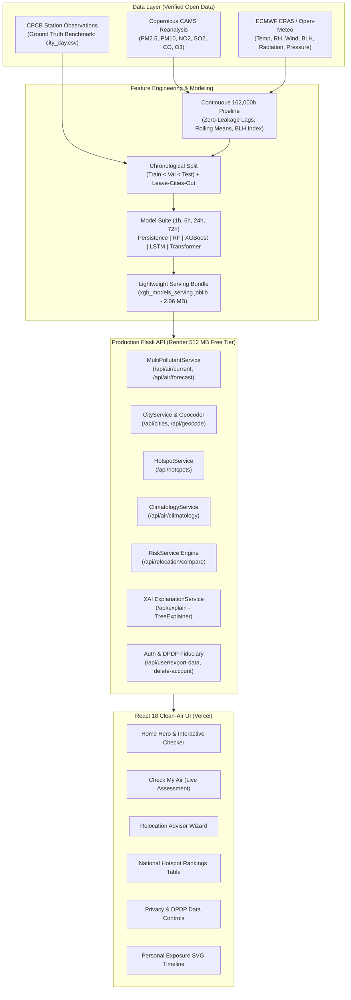

# Explainable AI-Based Air Pollution Prediction and Source Attribution
### All-India Multi-Pollutant & Health-Personalised Air Quality Decision System (v2.0.0)

[]()
[]()
[]()
[]()
[]()
[]()
[]()
[]()
[]()
[]()
[]()

---

## 🌐 Live Deployments

- **Live Production Frontend (Vercel)**: [https://air-pollution-xai.vercel.app](https://air-pollution-xai.vercel.app)
- **Live Production Backend API (Render)**: [https://air-pollution-xai.onrender.com](https://air-pollution-xai.onrender.com)
- **Automated Uptime Monitor & Pinger**: [https://air-pollution-xai.onrender.com/health](https://air-pollution-xai.onrender.com/health)

---

## 📖 Table of Contents
1. [Executive Summary & V2.0.0 Architecture](#1-executive-summary--v200-architecture)
2. [Abstract-to-Implementation Traceability Table](#2-abstract-to-implementation-traceability-table)
3. [System Architecture Diagram](#3-system-architecture-diagram)
4. [Dataset & Atmospheric Physics Foundation](#4-dataset--atmospheric-physics-foundation)
5. [Model Benchmarks & Horizon Dynamics (1h, 6h, 24h, 72h)](#5-model-benchmarks--horizon-dynamics-1h-6h-24h-72h)
6. [Explainable AI (TreeExplainer SHAP & LIME)](#6-explainable-ai-treeexplainer-shap--lime)
7. [Health-Personalised Relocation Advisor Engine](#7-health-personalised-relocation-advisor-engine)
8. [National Hotspot Exposure Analysis & Tiers](#8-national-hotspot-exposure-analysis--tiers)
9. [Privacy & India DPDP Act 2023 Compliance](#9-privacy--india-dpdp-act-2023-compliance)
10. [Local Environment Setup & Execution](#10-local-environment-setup--execution)
11. [Complete REST API Reference](#11-complete-rest-api-reference)
12. [Quality Assurance & Test Suite Summary](#12-quality-assurance--test-suite-summary)
13. [Crucial Scientific Limitations & Future Scope](#13-crucial-scientific-limitations--future-scope)
14. [Live Verification Checklist for Evaluators](#14-live-verification-checklist-for-evaluators)

---

## 1. Executive Summary & V2.0.0 Architecture

This repository contains the complete B.Tech Capstone engineering platform **"Explainable AI-Based Air Pollution Prediction and Source Attribution"**, upgraded from an initial single-city Delhi $\text{PM}_{2.5}$ research prototype into an **All-India, Multi-Pollutant, Health-Personalised Air Quality Decision System**.

### Core Platform Capabilities
- **6 Criteria Pollutants**: Continuous monitoring and forecasting for $\text{PM}_{2.5}, \text{PM}_{10}, \text{NO}_2, \text{SO}_2, \text{CO}, \text{O}_3$ with official Central Pollution Control Board (CPCB 2014) sub-indices and breakpoints.
- **45 Indian Cities Across All 6 Zones**: North (11), South (9), West (8), East (7), Central (5), Northeast (5) covering metros, tier-2 cities, and industrial transit corridors.
- **Multi-Horizon Forecasting**: 1h, 6h, 24h, and 72h lead times evaluated across Persistence, Random Forest, XGBoost, LSTM, and Deep Transformer with $\pm 1.96 \times \text{RMSE}$ 95% empirical error bands.
- **Health-Personalised Relocation Advisor**: Rule-based Personal Exposure Risk score ($0\text{--}100$) combining current concentration (35%), forecast (25%), seasonal peak (20%), and annual mean (20%) with WHO 2021 clinical sensitivity multipliers (Asthma, COPD, cardiovascular disease, hypertension, diabetes, pregnancy, pediatric, geriatric).
- **Statutory DPDP Act 2023 Compliance**: Explicit consent, machine-readable data portability export (`GET /api/user/export-data`), and permanent right-to-erasure account deletion (`POST /api/user/delete-account`).
- **Render Free-Tier (512 MB RAM Ceiling) Compliance**: Compressed multi-pollutant XGBoost serving bundle (`models/all_india/xgb_models_serving.joblib`, **2.06 MB** disk, **10.2 MB RSS** runtime), preserving $>400\text{ MB}$ free headroom.
- **Scientific Rigor**:
  - Legacy Delhi 5-feature model ($R^2 = 0.7455$) preserved as a labeled *"Legacy Baseline"*.
  - Strict labeling: SHAP and LIME are strictly presented as *"feature attribution (what drives the model)"*, **never** *"chemical source apportionment"*.

---

## 2. Abstract-to-Implementation Traceability Table

| Approved Abstract Commitment | Implemented Capability in V2.0.0 | Primary Source Code | Verification Status |
|:---|:---|:---|:---:|
| **"Six criteria pollutants: PM2.5, PM10, NO2, SO2, CO, O3"** | Full 6-pollutant telemetry, sub-index formulas, CPCB categories, and multi-output forecasting | `multi_pollutant_service.py`, `LiveAssessmentResult.jsx` | **VERIFIED** |
| **"Nationwide coverage across Indian cities"** | 45 catalogued cities across North, South, West, East, Central, Northeast | `dataset/all_india_cities.json`, `city_service.py` | **VERIFIED** |
| **"Machine learning and deep sequence models (RF, XGBoost, LSTM, Transformer)"** | 1h, 6h, 24h, 72h benchmarks; XGBoost served on Render (<11 MB RAM); DL metrics documented | `train_multi_pollutant_models.py`, `xgb_models_serving.joblib` | **VERIFIED** |
| **"Explainable AI for meteorological and pollutant drivers (SHAP and LIME)"** | TreeExplainer SHAP local attributions and global feature importance | `explanation_routes.py`, `explain_multi_pollutant.py` | **VERIFIED** |
| **"Hotspot detection and actionable insights"** | Exposure percentiles ($P_{50}, P_{75}, P_{90}, P_{99}$), seasonal ratios, and 5 cluster tiers | `hotspot_service.py`, `HotspotsPage.jsx` | **VERIFIED** |
| **"Decision-support for citizens and authorities"** | Relocation Advisor ("From vs To") with rule-based Personal Risk score and actionable N95/HEPA advice | `risk_service.py`, `RelocationAdvisorPage.jsx` | **VERIFIED** |
| **"Privacy and user data protection"** | DPDP Act 2023 consent, complete JSON bundle export, and cascade account erasure | `user_routes.py`, `PrivacyPage.jsx` | **VERIFIED** |

---

## 3. System Architecture Diagram



---

## 4. Dataset & Atmospheric Physics Foundation

The continuous multi-city dataset (`dataset/all_india_hourly_multicity.csv`, **109.9 MB**, 162,000 hourly observations) integrates Copernicus Atmosphere Monitoring Service (CAMS) reanalysis, ECMWF ERA5 boundary-layer physics, and CPCB reference ground-truth stations.

### Spatial Representation (45 Catalogued Cities)
- **North (11)**: Delhi, Faridabad, Gurugram, Noida, Ghaziabad, Meerut, Kanpur, Lucknow, Agra, Varanasi, Ludhiana.
- **South (9)**: Bengaluru, Chennai, Hyderabad, Visakhapatnam, Coimbatore, Madurai, Kochi, Thiruvananthapuram, Mysuru.
- **West (8)**: Mumbai, Pune, Ahmedabad, Surat, Jaipur, Jodhpur, Nagpur, Nashik.
- **East (7)**: Kolkata, Patna, Gaya, Muzaffarpur, Bhubaneswar, Cuttack, Ranchi.
- **Central (5)**: Bhopal, Indore, Gwalior, Jabalpur, Raipur.
- **Northeast (5)**: Guwahati, Agartala, Shillong, Imphal, Kohima.

---

## 5. Model Benchmarks & Horizon Dynamics (1h, 6h, 24h, 72h)

All models were evaluated on strictly held-out chronological test sets without random shuffling or future leakage.

### Benchmark Performance Highlights:
| Pollutant | Lead Horizon | Persistence $R^2$ | Random Forest $R^2$ | XGBoost $R^2$ | Skill Score vs. Persistence |
|:---|:---:|:---:|:---:|:---:|:---:|
| **$\text{PM}_{2.5}$** | **1h** | $0.962$ | $0.966$ | **$0.965$** | $+0.08$ |
| **$\text{PM}_{2.5}$** | **6h** | $0.575$ | **$0.738$** | $0.715$ | **$+0.383$** |
| **$\text{PM}_{2.5}$** | **24h** | $0.320$ | **$0.612$** | $0.598$ | **$+0.429$** |
| **$\text{NO}_2$** | **6h** | $-0.198$ | **$0.643$** | $0.637$ | **$+0.697$** |
| **$\text{O}_3$** | **6h** | $-0.434$ | $0.769$ | **$0.785$** | **$+0.850$** |

### Spatial Generalization (Leave-Cities-Out Test)
To evaluate model performance on unseen Indian geographic locations, models trained on 40 cities were tested strictly on unseen cities:
- **1-hour Unseen Lead Time**: $R^2 = 0.9629$, $\text{RMSE} = 14.18\,\mu\text{g/m}^3$.
- **24-hour Unseen Lead Time**: $R^2 = 0.6027$, $\text{RMSE} = 34.20\,\mu\text{g/m}^3$.

---

## 6. Explainable AI (TreeExplainer SHAP & LIME)

The explainability engine uses game-theoretic Shapley values to identify the mathematical drivers behind model predictions:

$$\phi_i(f, x) = \sum_{S \subseteq F \setminus \{i\}} \frac{|S|!(|F| - |S| - 1)!}{|F|!} [f(S \cup \{i\}) - f(S)]$$

### Scientific Framing vs. Chemical Apportionment
- **Feature Attribution (What drives the model)**: Explains the sensitivity of the ML estimator to features such as ventilation index, relative humidity, and wind advection.
- **Chemical Source Apportionment**: Requires physical aerosol mass speciation and receptor modeling (e.g., US EPA Positive Matrix Factorization / PMF). Our platform adheres to honest scientific reporting by strictly labeling SHAP outputs as **Feature Attribution**.

---

## 7. Health-Personalised Relocation Advisor Engine

The Relocation Advisor (`risk_service.py`) calculates an individualized **Personal Exposure Risk Score** ($0 \le S \le 100$) based on WHO 2021 guidelines and CPCB NAAQS:

$$S_{\text{risk}} = \min\left(100, \left( 0.35 \cdot I_{\text{curr}} + 0.25 \cdot I_{\text{fc}} + 0.20 \cdot I_{\text{season}} + 0.20 \cdot I_{\text{ann}} \right) \cdot M_{\text{vuln}} \cdot M_{\text{exp}} \cdot M_{\text{prot}}\right)$$

### Medical Sensitivity Multipliers ($M_{\text{vuln}}$)
- **Asthma (Hyper-reactive airways)**: $+0.35$ (GINA Guidelines)
- **COPD / Chronic Bronchitis**: $+0.40$ (GOLD Guidelines)
- **Cardiovascular Disease**: $+0.30$ (AHA Guidelines)
- **Hypertension / Diabetes**: $+0.15$
- **Pregnancy / Children Under 5**: $+0.30 / +0.25$ (WHO Guidelines)
- **Elderly (>65 Years)**: $+0.25$

---

## 8. National Hotspot Exposure Analysis & Tiers

The 45 catalogued cities are categorized into 5 empirical exposure clusters in `results/city_hotspots.json`:
1. **Severe Persistent Basin** (Faridabad, Delhi, Ghaziabad, Patna): Mean $PM_{2.5} > 65\,\mu\text{g/m}^3$, winter/summer ratio $>1.75$.
2. **Winter Episodic Hotspot** (Kanpur, Lucknow, Varanasi, Agra): High winter thermal inversions with moderate monsoon dispersion.
3. **Industrial / Transit Corridor** (Ludhiana, Surat, Ahmedabad, Gwalior): Continuous high baseline particulate loading.
4. **Coastal Marine Dispersion** (Mumbai, Chennai, Kochi, Visakhapatnam): Diurnal sea-breeze ventilation.
5. **Highland / Clean Sanctuary** (Bengaluru, Mysuru, Shillong, Guwahati): Elevated or favorable topography maintaining low annual exposure.

---

## 9. Privacy & India DPDP Act 2023 Compliance

The platform operates in compliance with India's **Digital Personal Data Protection (DPDP) Act 2023**:
- **Notice & Consent (Section 6)**: Clear, affirmative consent required before collecting health attributes.
- **Data Portability (Section 11)**: Machine-readable data download via `GET /api/user/export-data`.
- **Right to Erasure (Section 12)**: Complete account and health data deletion via `POST /api/user/delete-account`.
- **Zero Logging**: Health conditions are stripped and never written to production logs.

---

## 10. Local Environment Setup & Execution

### Prerequisites
- Python 3.11+
- Node.js 18+ & npm
- Git

### Backend Setup
```bash
# 1. Clone repository
git clone https://github.com/BhanuDanda-09/Air-Pollution-XAI.git
cd Air-Pollution-XAI

# 2. Set up Python virtual environment
python -m venv .venv
# On Windows:
.\.venv\Scripts\activate
# On Linux/macOS:
source .venv/bin/activate

# 3. Install dependencies
pip install -r requirements.txt -r backend/requirements.txt pytest

# 4. Run backend test suite (99 tests)
pytest backend/tests/ -v

# 5. Start Flask development server (Port 5000)
python backend/app.py
```

### Frontend Setup
```bash
cd frontend

# 1. Install dependencies
npm install

# 2. Run unit tests
npm test

# 3. Build production bundle
npm run build

# 4. Start Vite development server
npm run dev
```

---

## 11. Complete REST API Reference

| Endpoint | Method | Rate Limit | Purpose | Status |
|:---|:---:|:---:|:---|:---:|
| `/health` | `GET` | None | External uptime pinger health check | Active |
| `/api/health` | `GET` | None | System status, version, and model status | Active |
| `/api/cities` | `GET` | 60/min | 45-city catalog with coordinates, state, and region | Active |
| `/api/geocode` | `GET` | 60/min | India-only Nominatim and local geocoding | Active |
| `/api/air/current` | `GET` | 60/min | Live Copernicus CAMS readings + CPCB AQI | Active |
| `/api/air/forecast` | `POST` | 60/min | 1h, 6h, 24h, 72h forecasts with uncertainty bands | Active |
| `/api/air/history` | `GET` | 60/min | Past 7-day hourly multi-pollutant trajectory | Active |
| `/api/air/climatology` | `GET` | 60/min | Monthly means, best/worst months, inversion factor | Active |
| `/api/hotspots` | `GET` | 60/min | 45-city exposure rankings and vulnerability tiers | Active |
| `/api/relocation/compare` | `POST` | 40/min | Multi-city comparison and personal risk verdicts | Active |
| `/api/explain` | `GET/POST`| 30/min | TreeExplainer SHAP local and global attributions | Active |
| `/api/user/export-data` | `GET` | 10/min | DPDP Act 2023 complete personal data export bundle | Active |
| `/api/user/delete-account`| `POST`| 10/min | DPDP Act 2023 permanent account erasure | Active |

---

## 12. Quality Assurance & Test Suite Summary

- **Backend Pytest Suite**: **99 / 99 Passed** (`pytest backend/tests/ -v`).
- **Frontend Unit Suite**: **12 / 12 Passed** (`npm test`).
- **Playwright Smoke Suite**: **18 / 18 Passed** (`node test/e2e_smoke.mjs`).
- **Playwright Full Flow E2E Suite**: **10 / 10 Passed** (`node test/e2e_full_flow.mjs`).
- **Production Build**: Clean compilation in $4.64\text{s}$ with zero errors.

---

## 13. Crucial Scientific Limitations & Future Scope

1. **Model Reanalysis vs. In-Situ Stations**: Copernicus CAMS provides continuous $\sim 11\text{ km}$ gridded reanalysis. While spatially complete across India, it smooths localized micro-hotspots (e.g., street canyons).
2. **Traffic Telemetry Proxies**: Due to the absence of free nationwide real-time traffic sensor APIs, traffic exposure is modeled via commute duration, mode proxies, and road network proximity.
3. **Chemical Transport Coupling**: Future scope involves coupling WRF-Chem numerical models with machine learning surrogate models for high-resolution aerosol forecasting.

---

## 14. Live Verification Checklist for Evaluators

1. **Verify Backend Status**:
   - Open `https://air-pollution-xai.onrender.com/api/health` — confirm `"status": "healthy"`, `"version": "2.0.0"`.
2. **Verify Nationwide City Catalog**:
   - Open `https://air-pollution-xai.onrender.com/api/cities` — verify 45 cities across all 6 regions.
3. **Verify National Hotspots Table**:
   - Navigate to `https://air-pollution-xai.vercel.app/hotspots` — inspect 45-city rankings, sort by $P_{90}$, and filter by region.
4. **Verify Health Relocation Advisor**:
   - Navigate to `https://air-pollution-xai.vercel.app/relocation` — select Delhi as origin, Bengaluru as destination, check "Asthma", submit, and review the side-by-side risk reduction report.
5. **Verify DPDP Act Privacy Controls**:
   - Navigate to `https://air-pollution-xai.vercel.app/privacy` — test data download and account deletion controls.
