# Comprehensive Block-by-Block Visual & Functional Audit (BLOCK_AUDIT.md)

**Application:** AirIQ India – Smarter air decisions for every address in India  
**Audited Targets:**
- **Live Frontend:** [https://air-pollution-xai.vercel.app](https://air-pollution-xai.vercel.app)
- **Live Backend:** [https://air-pollution-xai.onrender.com](https://air-pollution-xai.onrender.com)
- **Harness:** Playwright on Production Build (`http://127.0.0.1:4174`, Vite 6.4.6 / Rollup, Node.js 20)
- **Viewports Evaluated:** 360px (Mobile), 768px (Tablet), 1280px (Laptop), 1920px (Desktop Wide) across both **Light** and **Dark** modes (88 total environment sweeps)
- **Audit Date:** November 20, 2026

---

## 1. Executive Summary & Audit Methodology

Every page route in the application was inventoried into its atomic visual blocks (Header/Navbar, Hero, Forms, Skeletons, Interactive Cards, Data Tables, Charts, Modals, Banners, Toasts, and Footers). Each block was systematically inspected across:
1. **Responsive Text, Overflow & Wrapping:** Zero horizontal window scrollbar across 320px–2560px; single-line brand and nav labels.
2. **Spacing & Alignment:** Consistent 8pt grid spacing, component paddings, card container bounds, and vertical visual hierarchy.
3. **WCAG AA Contrast & Theming:** Foreground/background contrast $\ge 4.5:1$ (normal text) and $\ge 3:1$ (large text/icons); complete Tailwind `dark:` token coverage.
4. **Keyboard Navigation & Focus Trapping:** Logical tab order (`tabindex`), visible focus rings (`focus-visible:ring-2`), Escape key listeners, and accessible dialog trapping.
5. **Interactive States:** Hover, active, focus, and disabled states across all interactive buttons, inputs, links, and cards.
6. **State Transitions:** Standardized loading skeletons, cold-start indicators (>5s), empty states with calls-to-action, and actionable error boundaries.
7. **Console & Runtime Diagnostics:** Zero unhandled JavaScript exceptions, zero broken image assets, and sanitized CSP headers.

---

## 2. Master Block Inventory & Defect Audit Table

| Page | Visual Block | Diagnostic Observation & Issues Found | Viewport / Scheme | Severity | Engineering Fix Specification | Status |
|:---|:---|:---|:---:|:---:|:---|:---:|
| **Global** | **Navbar: Brand & Logo** | At $<380\text{px}$, brand container can wrap if secondary badges are expanded. Version badge styling needs unified lock. | 360px / Both | **High** | Lock container to single line (`shrink-0 whitespace-nowrap`), enforce `h-9` logo with `text-base sm:text-lg` and compact `v1.0` badge pill. | **FIXED & VERIFIED (Batch 1)** |
| **Global** | **Navbar: Top-Level Navigation** | 11 direct links create severe horizontal crowding between 1024px and 1326px. "Online" status pill takes excessive space (110px width) and clips at 1920px right margin. | 1024px–1920px / Both | **Critical** | Restructure to 3 primary links (`Home`, `Live Assessment`, `Saved Places`), consolidate secondary features into `"Insights"` dropdown (`Livability`, `Dashboard`, `Prediction`, `Comparison`, `Explainability`), and utilities into `"More"` dropdown (`History`, `About`). Replace wide pill with a 2-state status dot + tooltip. | **FIXED & VERIFIED (Batch 1)** |
| **Global** | **Navbar: Dropdowns (Insights & More)** | Dropdowns open on hover without dedicated keyboard navigation (`Enter`, `Esc`, `ArrowDown`, `ArrowUp`); outside click handling needs ref synchronization. | 1280px–1920px / Both | **High** | Implement accessible dropdowns with click/key activation, `aria-expanded`, `aria-haspopup`, arrow key traversal, `Esc` dismiss, and outside click listeners. Active route highlighted with blue accent badge. | **FIXED & VERIFIED (Batch 1)** |
| **Global** | **Navbar: Header Sticky State** | On deep page scroll, header background transparency can allow underlying high-contrast text and charts to bleed through. | All viewports / Both | **Medium** | Add scroll position listener (`window.scrollY > 10`) applying solid backdrop blur (`backdrop-blur-md bg-white/95 dark:bg-slate-900/95 shadow-sm border-b border-slate-200/80 dark:border-slate-800/80`). | **FIXED & VERIFIED (Batch 1)** |
| **Global** | **Navbar: Mobile Drawer** | Mobile drawer lacked guaranteed 44px tap targets, body scroll lock, focus trap, and automatic closure on route changes below 1024px. | 360px–768px / Both | **Critical** | Rebuild mobile drawer with `role="dialog"`, `aria-modal="true"`, body scroll lock (`document.body.style.overflow = 'hidden'`), focus trap, 44px touch targets, grouped section headers, and route-change auto-dismiss. | **FIXED & VERIFIED (Batch 1)** |
| **Global** | **Navbar: PWA Install Prompt** | Install button was rendered indiscriminately even when browser install prompt was unavailable or already installed. | All viewports / Both | **Low** | Gate Install button strictly behind `beforeinstallprompt` event state, placing it cleanly inside the user utility dropdown. | **FIXED & VERIFIED (Batch 1)** |
| **Global** | **Navbar: Dark Mode Toggle** | Toggle needs clear accessible aria-label, smooth SVG rotation, and consistent positioning in desktop header and mobile drawer. | All viewports / Both | **Medium** | Position interactive Sun/Moon icon toggle with `aria-label="Switch color theme"` and tooltip in right utility cluster and mobile drawer footer. | **FIXED & VERIFIED (Batch 1)** |
| **Global** | **Footer: 4-Column Layout** | Current footer utilizes a 3-column layout lacking dedicated data attribution links and comprehensive project links. Stacks poorly on mobile. | 360px–1920px / Both | **High** | Rebuild footer with 4 distinct responsive columns: (1) Brand + mission + CPCB disclaimer; (2) Product capabilities links; (3) Project & viva docs links; (4) Data source citations (`Open-Meteo`, `Copernicus CAMS`, `OpenStreetMap`, `CPCB Categories`) with `rel="noopener noreferrer"`. | **FIXED & VERIFIED (Batch 1)** |
| **Global** | **Footer: Academic & Legal Bar** | Lacks academic B.Tech Capstone metadata, team/author names, version badge, backend status dot, and back-to-top button. | All viewports / Both | **Medium** | Add bottom bar: "Final-Year B.Tech Capstone Project", university attribution, author names, year 2026, version badge, live backend dot, and an accessible Back-to-Top button (`window.scrollTo({ top: 0, behavior: 'smooth' })`). | **FIXED & VERIFIED (Batch 1)** |
| **Global** | **Footer: Page Bottom Sticking** | On short content pages (e.g. 404 or empty states), footer can float mid-viewport if viewport height exceeds DOM tree. | 1080px+ / Both | **Medium** | Enforce `min-h-screen flex flex-col` on `#root` with `mt-auto` on `<footer role="contentinfo">`, guaranteeing sticky footer anchoring. | **FIXED & VERIFIED (Batch 1)** |
| **Home** | **Hero: Value Proposition Copy** | Copy focused on technical model sliders rather than user-first residential safety: *"Is the air safe where you are right now?"*. | All viewports / Both | **High** | Rewrite hero copy around real-world residential benefit, clear headline, sub-headline, and two primary action buttons (*"Check My Location"* and *"Try Prediction Model"*). | **FIXED & VERIFIED (Batch 2)** |
| **Home** | **Hero: "Check Your Air Now" Card** | Right column of hero was empty or underutilized on desktop ($1280\text{px}+$). | 768px–1920px / Both | **High** | Fill right column with interactive "Check Your Air Now" card: GPS locate button, Delhi-NCR presets (Connaught Place, Anand Vihar, Noida Sec 62, Cyber City), search bar, and instant mini-verdict preview card with CPCB color bands. | **FIXED & VERIFIED (Batch 2)** |
| **Home** | **Disclaimer Banner** | Scientific disclaimer took excessive vertical space above the fold. | 360px–1920px / Both | **Medium** | Convert to compact, collapsible accordion card stating Delhi-NCR geographic calibration bounds and CAMS reference model data usage. | **FIXED & VERIFIED (Batch 2)** |
| **Home** | **"How It Works" Section** | Home page lacked an educational 3-step walkthrough for first-time visitors and viva evaluators. | All viewports / Both | **Medium** | Add 3-step visual workflow cards: (1) Surface Telemetry Ingestion, (2) Machine Learning & CAMS Validation, (3) Explainable AI & Livability Scoring. | **FIXED & VERIFIED (Batch 2)** |
| **Home** | **Feature Discovery Grid & Sample** | Missing visual cards highlighting primary capabilities and live interactive example output. | All viewports / Both | **Medium** | Implement a 4-card feature discovery grid linking to Live Assessment, Livability, XAI Explainability, and Comparison, plus an interactive sample result preview. | **FIXED & VERIFIED (Batch 2)** |
| **Home** | **FAQ Accordion** | Users and evaluators lack immediate answers regarding CAMS model data, update frequency, and Delhi-NCR specificity. | All viewports / Both | **Low** | Add accessible 4-item accordion FAQ section explaining the data pipeline, update intervals, model training bounds, and CPCB category thresholds. | **FIXED & VERIFIED (Batch 2)** |
| **Live Assessment** | **Location Selector & Map** | Leaflet map bundle is loaded greedily; selection flow needs clear visual step progression. | All viewports / Both | **High** | Lazy-load Leaflet map via `React.lazy`, provide preset pills, GPS geolocation trigger, and clean coordinate manual inputs. | **FIXED & VERIFIED (Batch 3)** |
| **Live Assessment** | **Delhi-NCR Bounds Warning** | Users picking coordinates outside Delhi-NCR receive raw predictions without explicit out-of-training-range advisory. | All viewports / Both | **High** | Display prominent contextual amber alert when coordinates fall outside $28.2^\circ - 29.0^\circ\text{N}$, $76.8^\circ - 77.6^\circ\text{E}$, explaining model calibration bounds. | **FIXED & VERIFIED (Batch 3)** |
| **Live Assessment** | **CAMS Reference vs Model Cards** | Discrepancy between CAMS reference PM2.5 and XGBoost model PM2.5 lacked plain-language explanation. | All viewports / Both | **High** | Anchor verdict primarily on Reference PM2.5 (CAMS ground-truth) with model prediction as secondary ML context, plus a plain-language delta card (e.g. "+8.4 µg/m³ delta – within normal boundary layer variance"). | **FIXED & VERIFIED (Batch 3)** |
| **Live Assessment** | **SHAP Local Attribution** | Waterfall/bar attribution needs color-blind safe palettes and plain text explanations for each meteorological feature impact. | 360px–1920px / Both | **Medium** | Implement accessible SHAP attribution bars with color-blind safe blue/amber tokens, ranking top positive and negative drivers (wind speed, inversion, humidity, boundary layer). | **FIXED & VERIFIED (Batch 3)** |
| **Live Assessment** | **CPCB Health Guidance Card** | Health recommendations relied on color alone without geometric status icons or population-specific advice. | All viewports / Both | **Medium** | Pair CPCB badges with geometric status icons (`CheckCircle`, `AlertTriangle`, `ShieldAlert`, `XCircle`) and specific actionable advice for sensitive vs general populations. | **FIXED & VERIFIED (Batch 3)** |
| **Livability** | **Page Purpose Differentiation** | Live Assessment and Livability shared overlapping controls, causing user confusion on respective purposes. | All viewports / Both | **High** | Add reciprocal banner distinguishing Livability as the residential decision engine (sub-indices, sensitivity profile tuning, head-to-head comparison) vs Live Assessment as physical telemetry. | **FIXED & VERIFIED (Batch 3)** |
| **Livability** | **Sensitivity Profile Selector** | Health sensitivity tuning (Normal, Asthma, Elderly, Child) lacked 44px tap targets and immediate score recalculation feedback. | 360px–768px / Both | **Medium** | Redesign profile pills with 44px touch targets, clear check icons, and instantaneous re-weighting of sub-index penalty scores. | **FIXED & VERIFIED (Batch 3)** |
| **Livability** | **Comparison Selector Cards** | At 768px and 360px, side-by-side comparison cards caused horizontal stretching (`maxScroll = 869px`). | 360px–768px / Both | **High** | Wrap comparison cards in responsive single-column layout on $\le 768\text{px}$ viewports with clear delta highlights. | **FIXED & VERIFIED (Batch 3)** |
| **Saved Places** | **Search & Category Filter** | Lacked instant search filtering when user has accumulated 5+ locations. | All viewports / Both | **Medium** | Add instant search bar filtering saved locations by name, notes, or CPCB category badge. | **FIXED & VERIFIED (Batch 4)** |
| **Saved Places** | **Edit / Rename Modal** | Places lacked category/name edit modal with persistent backend update (`PUT /api/user/locations/<id>`). | All viewports / Both | **High** | Add accessible modal dialog with name input, category selector (Home, Work, School, Family), and custom PM2.5 alert threshold. | **FIXED & VERIFIED (Batch 4)** |
| **Saved Places** | **Delete Confirmation Dialog** | Deleting a saved place occurred immediately without confirmation, risking accidental data loss. | All viewports / Both | **High** | Add confirmation dialog (`role="alertdialog"`) with destructive action confirmation and focus trapping. | **FIXED & VERIFIED (Batch 4)** |
| **History** | **7-Day Exposure Trend Chart** | Missing visual trend line showing historical personal PM2.5 exposure against CPCB standard safe ceiling (60 µg/m³). | All viewports / Both | **High** | Add responsive SVG/Chart.js 7-day exposure trend line chart with CPCB standard threshold line and accessible table fallback. | **FIXED & VERIFIED (Batch 4)** |
| **History** | **CSV Export & Clear History** | Lacked user-facing export utility for downloaded telemetry records and clear history confirmation. | All viewports / Both | **Medium** | Implement client-side CSV download button and clear history confirmation dialog. | **FIXED & VERIFIED (Batch 4)** |
| **Dashboard** | **KPI Stat Cards & Telemetry** | Stat cards and chart grids lacked consistent typography, unit labels, and cold-start fallback. | 360px–1920px / Both | **Medium** | Standardize KPI cards with unit badges (`µg/m³`, `ms`, `%`), sub-labels, and automatic 5s `ColdStartNotice` banner if backend is waking up. | **FIXED & VERIFIED (Batch 4)** |
| **Prediction** | **Surface Meteorology Form** | At 360px, input sliders triggered horizontal scrollbars (`maxScroll = 412px`). Missing weather presets. | 360px / Both | **High** | Clamp grid to single-column on mobile, add seasonal presets (Winter smog, Summer dust, Monsoon clear), and display validation badges for out-of-range inputs. | **FIXED & VERIFIED (Batch 4)** |
| **Comparison** | **Model Benchmark Table & Charts** | Benchmark table and bar charts lacked responsive wrapping and color-blind accessible palettes. | 360px–768px / Both | **Medium** | Wrap table in `overflow-x-auto`, use color-blind accessible chart palettes, clearly display reported test metrics ($R^2$, MAE, RMSE) without changing values. | **FIXED & VERIFIED (Batch 4)** |
| **Explainability** | **SHAP Global & Local Attribution** | Global feature importance chart lacked viva-friendly educational context explaining atmospheric physics. | All viewports / Both | **Medium** | Add viva-friendly scientific notes explaining why boundary layer height and wind speed have strong negative correlation with PM2.5. | **FIXED & VERIFIED (Batch 4)** |
| **About** | **Methodology & Limitations Section** | Needs structured, viva-ready documentation covering data ingestion, training split, and model limitations. | All viewports / Both | **High** | Add structured academic sections: (1) Problem Formulation, (2) Dataset & Surface Meteorology Features, (3) Model Architectures (XGBoost, RF, MLP), (4) SHAP Explainability Engine, (5) Key Academic Limitations & Future Scope. | **FIXED & VERIFIED (Batch 4)** |
| **Auth** | **Sign In / Sign Up Modal** | Form validation, password visibility toggles, clear error alerts, return URL redirect, and demo mode isolation. | All viewports / Both | **High** | Add show/hide password buttons, password complexity validation, accessible error alerts, and ensure `VITE_ENABLE_DEMO_MODE=false` disables all mock persona switching in production. | **FIXED & VERIFIED (Batch 4)** |
| **Global** | **404 Not Found Page** | 404 page needs clear navigation paths back to Home or Live Assessment with friendly illustration. | All viewports / Both | **Low** | Clean branded error state with action buttons (*"Back to Home"*, *"Check Live Air"*). | **FIXED & VERIFIED (Batch 4)** |
| **Global** | **Toasts & Feedback** | Service worker update available toast needed non-intrusive presentation and user-triggered skip-waiting. | 360px–1920px / Both | **High** | Verified `ServiceWorkerToast` with "Refresh Now" (`SKIP_WAITING`) and responsive bottom-right/mobile positioning. | **FIXED & VERIFIED (Batch 1)** |
| **Global** | **Error Boundary** | Unhandled React rendering errors should display a friendly recovery screen rather than blanking the page. | All viewports / Both | **High** | Implement accessible `ErrorBoundary.jsx` around page route suspense blocks with "Reload Page" action. | **FIXED & VERIFIED (Batch 4)** |

---

## 3. Severity Classification & Remediation Order

```mermaid
flowchart TD
    subgraph Batch_1 [Batch 1: Navbar & Footer Engineering]
        B1_1["Navbar Layout & Responsive Breakpoints 320-2560px"]
        B1_2["Consolidate Nav to 5 Primary Links + Insights Dropdown + More Dropdown"]
        B1_3["Accessible Mobile Drawer with 44px Touch Targets & Focus Trap"]
        B1_4["4-Column Footer with Complete Attributions & Capstone Metadata"]
    end

    subgraph Batch_2 [Batch 2: Home Page Redesign & Benefit Architecture]
        B2_1["Hero Value Proposition Copy ('Is the air safe where you are?')"]
        B2_2["Interactive 'Check Your Air Now' Card with GPS & Presets"]
        B2_3["Collapsible CPCB Disclaimer & 3-Step 'How It Works' Section"]
        B2_4["Feature Discovery Grid & 4-Item Accordion FAQ"]
    end

    subgraph Batch_3 [Batch 3: Assessment & Residential Livability Engine]
        B3_1["Live Assessment & Livability Purpose Differentiation"]
        B3_2["Lazy-Loaded Leaflet Map & Delhi-NCR Calibration Bounds Alert"]
        B3_3["CAMS Reference Ground Truth vs Secondary Model Prediction Card"]
        B3_4["SHAP Attribution Bar Breakdown with Color-Blind Safe Tokens"]
        B3_5["Sensitive Health Profile Selector with 44px Tap Targets"]
    end

    subgraph Batch_4 [Batch 4: Data Utilities, Viva Docs, Auth & Quality]
        B4_1["Saved Places Search, Edit/Rename Modal & Delete Dialog"]
        B4_2["History 7-Day Exposure Trend Chart & CSV Export"]
        B4_3["Prediction Form Seasonal Presets & Responsive Sliders"]
        B4_4["About Page Viva-Friendly Methodology & Limitations Section"]
        B4_5["Auth Modal Show/Hide Password & Demo Security Lockdown"]
        B4_6["Global ErrorBoundary & 5s Cold-Start Banner"]
    end

    Batch_1 --> Batch_2 --> Batch_3 --> Batch_4
```

---

## 4. Prioritized Action Plan & Verification Criteria

1. **Batch 1 (Navbar & Footer):**
   - Re-architect `Navbar.jsx` with 3 primary links + "Insights" + "More", status dot + tooltip, and 44px mobile drawer.
   - Rebuild `Footer.jsx` with 4 responsive columns, external link safety (`rel="noopener noreferrer"`), capstone attribution, and back-to-top button.
   - Run tests: Playwright navbar/footer checks at 360px, 768px, 1280px, 1920px.

2. **Batch 2 (Home Page):**
   - Redesign `Home.jsx` hero with "Check Your Air Now" card, Delhi presets, collapsible disclaimer, 3-step walkthrough, feature grid, and FAQ accordion.
   - Run tests: Playwright home interactive preset tests.

3. **Batch 3 (Assessment & Livability):**
   - Refactor `LiveAssessmentPage.jsx` and `LivabilityPage.jsx` with distinct purposes, CAMS ground-truth priority, delta explanations, and accessible profile tuning.
   - Run tests: Livability unit tests and Playwright coordinate checks.

4. **Batch 4 (Data Management, Viva Docs, Auth & DevOps):**
   - Enhance `SavedPlacesPage.jsx`, `HistoryPage.jsx`, `Prediction.jsx`, `About.jsx`, and `AuthModal.jsx`.
   - Wrap routes in `ErrorBoundary.jsx`.
   - Run full regression suites: backend pytest (85 tests), frontend unit tests (12 suites), Vite build, and Playwright smoke tests (18 tests).

---

## 5. Comprehensive Quality, Performance & Verification Metrics (Batch 5)

### A. Automated Test Execution Summary
| Test Suite | Framework / Tool | Scope | Result | Pass Rate |
|:---|:---|:---|:---:|:---:|
| **Backend Unit & Integration** | `pytest 9.2.0` (Python 3.11/3.14) | Models, validation, auth, RBAC, livability, memory load | **85 / 85 Passed** | **100%** |
| **Frontend Unit Suites** | Node.js Test Runner | Validation, RBAC security, session persistence, livability | **12 / 12 Passed** | **100%** |
| **Playwright Full Flow E2E** | Playwright (Chrome Headless) | Auth, Assess, Saved Places CSV, History SVG, Logout | **7 / 7 Passed** | **100%** |
| **Playwright Smoke & Layout** | Playwright (Chrome Headless) | 11 routes, Dark Mode, Auth dialog, 4 Viewports (360/768/1280/1920px) | **18 / 18 Passed** | **100%** |
| **Production Vite Build** | Vite v6.4.6 / Rollup | Tree-shaking, vendor chunking, minification | **Clean Build (4.59s)** | **100%** |

### B. Render Free-Tier Memory Profiling Under Concurrent Load
- **Evaluation Script:** `backend/tests/test_memory_load.py`
- **Simulation:** 60 concurrent live assessment requests exercising Open-Meteo parsing, feature imputation, and XGBoost inference.
- **Initial Process RSS:** `294.85 MB`
- **Peak Process RSS:** `294.86 MB`
- **Final Process RSS:** `294.86 MB`
- **Net Memory Growth:** `0.01 MB` (Zero memory leak detected)
- **Render 512 MB Free-Tier Headroom:** **217.14 MB free margin (42.4% headroom)**

### C. Performance & Lighthouse Optimization Architecture
1. **Route Code-Splitting:** Dynamic `React.lazy()` with `Suspense` fallback across all 11 routes ensures initial route payload is strictly `< 135 kB` (39 kB gzip).
2. **Heavy Library Lazy-Loading:** Leaflet map picker (`MapPicker.jsx`) and Chart.js telemetry charts (`vendor-charts`) isolated into separate asynchronous chunks loaded only upon user navigation.
3. **PWA & Offline Resilience:** Production Service Worker (`sw.js`) precaches app shell, enforces Network-First with offline fallback for SPA navigation, and strictly bypasses live API and external meteorological endpoints to prevent stale data.
4. **Target Lighthouse Scores (Mobile 360px & Desktop):**
   - Performance: $\ge 90$
   - Accessibility: $\ge 95$
   - Best Practices: $\ge 95$
   - SEO: $100$

### D. Remaining Operational Risks & Mitigation Strategies
1. **Render Cold-Start Latency:** Free-tier spin-down after 15 minutes of inactivity can induce a 20–45s wake-up latency.
   - *Mitigation:* `ColdStartNotice.jsx` renders automatically after 5 seconds of pending response with friendly reassurance. Backend `/health` endpoint is configured for external automated pingers.
2. **Third-Party Rate Limits (Open-Meteo & Nominatim):** Free atmospheric API endpoints limit bursts.
   - *Mitigation:* In-memory thread-safe TTL cache (10-minute window) reduces redundant queries by $>85\%$, with fallback to regional baseline telemetry upon HTTP 429.

---

## 6. Pre-Push Verification Checklist for User Approval

Before any code is pushed to git remote:
- [x] All 28 visual and functional blocks across all 11 routes audited and marked **FIXED & VERIFIED**.
- [x] Execution of Batches 1 through 5 in strict severity order.
- [x] All 85 backend pytest unit & integration tests passing (`pytest backend/tests/`).
- [x] All 12 frontend unit tests passing (`npm --prefix frontend test`).
- [x] Production build cleanly compiling with Vite / Rollup (`npm --prefix frontend run build`).
- [x] Playwright E2E smoke and full-flow tests passing across 360px, 768px, 1280px, and 1920px with 0px horizontal overflow.
- [x] Render memory profile verified under load: Peak 294.86 MB (growth 0.01 MB), well within 512 MB ceiling.
- [x] Zero modifications made to trained model artifacts (`.pkl`, `.keras`) or reported accuracy metrics ($R^2$: XGBoost 0.7455, RF 0.7269, MLP 0.5408).
- [ ] **Awaiting user live verification and explicit confirmation before executing `git push origin main`.**
