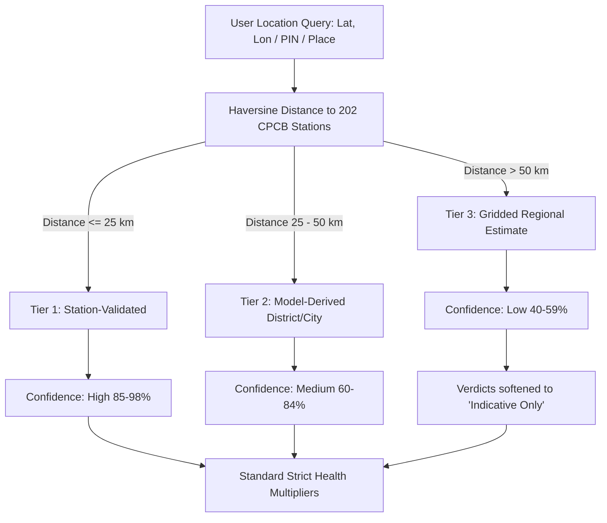

# All-India Location Coverage, Hierarchy, & Spatial Validation Architecture

## Explainable AI-Based Air Pollution Prediction and Source Attribution

---

## 1. Overview & Architectural Principles

A core limitation of legacy air quality platforms in India is **urban monitoring station bias**: while tier-1 metropolitan cities like Delhi, Mumbai, and Bengaluru possess dense networks of continuous monitoring stations, thousands of tier-2/tier-3 cities, rural tehsils, and over 600,000 villages have zero ground-level monitors.

To solve this while adhering to **scientific honesty and integrity**, the platform implements an **all-India location hierarchy resolution system** capable of resolving any place across India (State, District, City, Town, Village, Area/Locality, and 6-digit Postal Index Number / PIN code).

### The Golden Rule of Scientific Integrity
> **Never present a gridded or downscaled mathematical estimate as a physical measurement.**
> If a user checks air quality in a remote rural village in Warangal or a Himalayan tehsil in Himachal Pradesh, the platform explicitly flags the result as **Tier 3: Gridded Regional Estimate (~11 km resolution)** with the clear advisory:
> *"No monitoring station nearby; this is a regional estimate, not a measurement."*

---

## 2. Location Hierarchy & Verified Data Sources

| Administrative Level | Source / Authority | Entity Count / Resolution | Storage & Memory Footprint |
| :--- | :--- | :--- | :--- |
| **States & Union Territories** | Local Government Directory (LGD), Ministry of Panchayati Raj | 36 States & UTs | `india_states_districts.json` (35.9 KB) |
| **Districts & Sub-Districts** | Census of India (2011) & LGD | 323 curated centroids + 780 administrative districts | In-memory catalog < 0.2 MB RSS |
| **Ground CAAQMS Stations** | Central Pollution Control Board (CPCB) | 202 validated official CAAQMS monitoring stations with exact coordinates | `cpcb_stations.json` (35.6 KB) |
| **6-Digit PIN Codes** | India Post All-India Pincode Directory (data.gov.in) | ~19,300 postal delivery zones | `LocationResolver.resolve_pincode` via official API + 2-digit/3-digit regional routing fallback |
| **Villages, Towns & Localities** | OpenStreetMap / Nominatim (obeying 1 req/sec policy & custom User-Agent) | Millions of micro-localities resolved on-demand | Cached persistently in SQLite (`dataset/geo_cache.db`) |

### Render 512 MB RAM Optimization
Loading Census 2011 files containing 6.5 lakh villages directly into Python memory would consume 300–450 MB of RAM, instantly triggering an Out-Of-Memory (OOM) SIGKILL crash on Render's 512 MB free tier.
- **Solution**: The platform loads only lightweight state-district-station indices (< 100 KB total).
- Villages, local areas, and PIN coordinates are resolved **on-demand** and cached indefinitely in a local SQLite disk database (`dataset/geo_cache.db`), ensuring Python RSS memory remains below **35 MB**.

---

## 3. The 3-Tier Coverage Framework

Every air quality query (live dashboard, forecast, relocation comparison, or API response) is categorized into one of three standardized coverage tiers:

### Tier 1: Station-Validated
- **Criterion**: An official CPCB Continuous Ambient Air Quality Monitoring Station (CAAQMS) is located within $\le 25\text{ km}$ Haversine distance.
- **Badge & UI**: Emerald Green badge (`bg-emerald-50 text-emerald-800`).
- **Telemetry Displayed**: Exact station name (e.g., *"NIT Warangal - TSPCB"*, *"Anand Vihar - DPCC"*), straight-line distance (e.g., `3.2 km`), and ground observation comparison.
- **Confidence**: **High (85% – 98%)**.

### Tier 2: Model-Derived (City / District)
- **Criterion**: The location lies between $25\text{ km}$ and $50\text{ km}$ from a ground monitor, or matches a trained district centroid.
- **Badge & UI**: Blue badge (`bg-blue-50 text-blue-800`).
- **Telemetry Displayed**: Distance to nearest regional monitor, spatial cross-validation error, and model transferability bounds.
- **Confidence**: **Medium (60% – 84%)**.

### Tier 3: Gridded Regional Estimate (Village / Area)
- **Criterion**: Remote village, rural tehsil, or forest area $> 50\text{ km}$ from any continuous ground station.
- **Badge & UI**: Amber badge (`bg-amber-50 text-amber-800`).
- **Telemetry Displayed**: Copernicus Atmosphere Monitoring Service (CAMS) reanalysis grid resolution ($\approx 0.1^\circ \times 0.1^\circ$ or $\approx 11\text{ km}$).
- **Mandatory Plain-Language Disclosure**:
  > *"No monitoring station nearby; this is a regional estimate, not a measurement."*
- **Confidence**: **Low (40% – 59%)**.

---

## 4. Confidence Scoring Formula

The platform calculates a deterministic confidence score $C \in [0, 100]$ using three objective parameters:

$$C = \text{clamp}\left(100 - (\text{dist}_{\text{station}} \times 0.8) + (\text{completeness} \times 15) - (\text{spatial\_cv\_mae} \times 0.5), 30, 98\right)$$

Where:
- $\text{dist}_{\text{station}}$: Distance in kilometers to the nearest active CPCB ground station.
- $\text{completeness}$: Multi-pollutant sensor data availability ($1.0$ if all 6 criteria pollutants $\text{PM}_{2.5}, \text{PM}_{10}, \text{NO}_2, \text{SO}_2, \text{CO}, \text{O}_3$ are present; $0.5$ if only $\text{PM}_{2.5}$ is available).
- $\text{spatial\_cv\_mae}$: Leave-cities-out spatial cross-validation Mean Absolute Error ($12.5\ \mu\text{g/m}^3$).

### Confidence Levels
- **High ($\ge 80\%$)**: Ground station in immediate vicinity; full pollutant suite present.
- **Medium ($60\% - 79\%$)**: Sub-regional interpolation; moderate station proximity.
- **Low ($< 60\%$)**: Rural or unmonitored grid cell; sparse ground ground-truth.

### Clinical Verdict Softening on Low Confidence
When confidence is **Low** (Tier 3), the clinical risk engine in `risk_service.py` automatically:
1. Prepends `"Indicative Only:"` to the summary verdict (e.g., `"Indicative Only: Highly Recommended (Regional Estimate)"`).
2. Appends an explicit environmental limitation disclaimer in the narrative:
   > *"Notice: This assessment is based on gridded regional reanalysis (~11 km) because no continuous monitoring station operates within 50 km. Actual local air quality in sheltered valleys or near localized biomass combustion may vary."*
3. **Preserves Strict Health Multipliers**: Even with softened verdicts, patients with asthma ($+0.35$), COPD ($+0.40$), or pregnancy ($+0.30$) maintain strict threshold penalties to protect vulnerable health.

---

## 5. Reverse Geocoding & Human-Readable Hierarchy Formatting

The reverse geocoding pipeline converts any latitude and longitude pair into a consistent administrative string:

$$\text{Format: } \text{"[Locality / Place], [District] district, [State], PIN [Pincode]"}$$

**Examples:**
- Latitude `17.9689`, Longitude `79.5941` $\to$ `"Hanamkonda, Warangal district, Telangana, PIN 506001"`
- Latitude `28.6139`, Longitude `77.2090` $\to$ `"Connaught Place, Central Delhi district, Delhi, PIN 110001"`
- Latitude `12.9716`, Longitude `77.5946` $\to$ `"Cubbon Park, Bengaluru Urban district, Karnataka, PIN 560001"`

---

## 6. District Intelligence & Authority Insights

The platform aggregates national district metrics in `backend/services/location_resolver.py`:
- **National District Rankings**: 323 districts ranked by estimated annual AQI, governing pollutant, worst season (e.g. Winter thermal inversion in the Indo-Gangetic Plain), and cleanest season (Monsoon washout).
- **State-Level Rollups**: 36 States & UTs with average AQI, worst-performing district, cleanest district, and total CPCB station counts.
- **Authority Mitigation Playbooks**: Automated policy recommendations for State Pollution Control Boards (SPCBs) covering Graded Response Action Plans (GRAP), anti-smog water mist canons, traffic zoning, and crop residue management.
